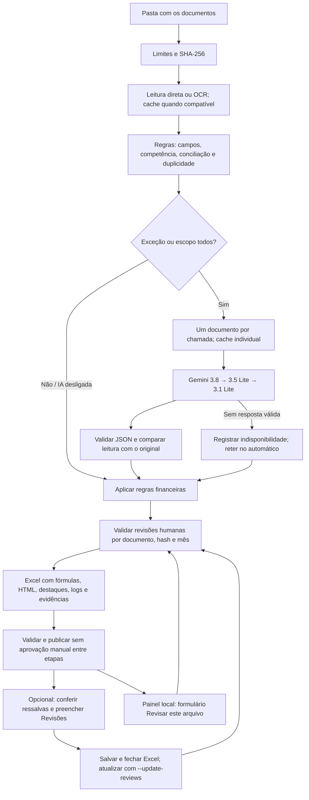
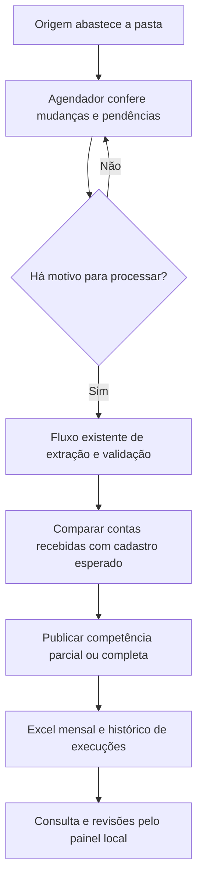
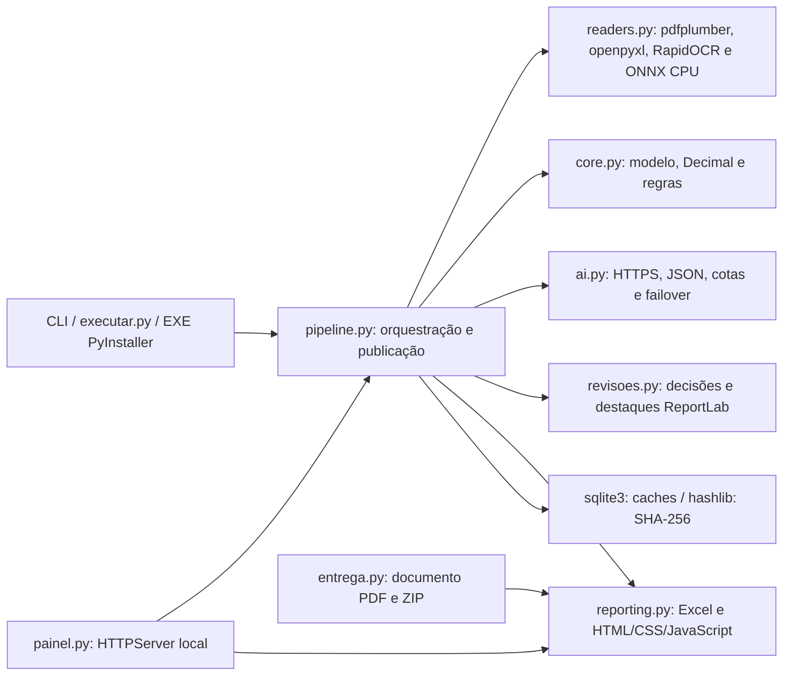

# Goener — consolidação de saldos bancários

Automação em Python que lê uma pasta de extratos e publica Excel, HTML, logs e evidências. O fluxo principal termina sem intervenção manual entre etapas. Regras financeiras fazem a primeira conferência; o Gemini complementa as exceções. A revisão posterior é opcional e fica registrada.

**Versão 1.9.0.** Resultado do lote: **17 arquivos, 12 ok, 4 revisar e 1 falhou**, com **R$ 4.114.372,29 incluídos no fechamento**. Uma cópia exata foi identificada e excluída da soma. Os documentos são fictícios, fornecidos para o case.

Três níveis de leitura:

1. **[Usar e avaliar](#1-usar-e-avaliar):** execução, entregáveis e revisões, sem conhecer o código.
2. **[Metodologia e regras](#2-metodologia-e-regras):** mapeamento, premissas, exceções, IA e horas estimadas.
3. **[Referência técnica](#3-referência-técnica):** stack, arquitetura, OCR, HTTP/JSON, caches, parâmetros e validação.

## 1. Usar e avaliar

### Executar no Windows, sem instalar Python

1. Extraia **todo o ZIP** `entrega/goener_automacao.zip` em uma pasta com permissão de escrita.
2. Entre na pasta `goener-case/` extraída. Mantenha `Goener.exe`, `config.toml`, `modelo.xlsx`, `.env` e a pasta `extratos/` juntos.
3. Coloque os documentos em `extratos/` e execute `Goener.exe`.

Também é possível executar pelo PowerShell, mantendo as mensagens visíveis:

```powershell
.\Goener.exe
.\Goener.exe --ai-mode off
.\Goener.exe --period 2026-11
```

O executável inclui o interpretador Python, bibliotecas e modelos OCR. Foi construído para **Windows x64**; não é um executável de Linux ou macOS. O modo de arquivo único extrai bibliotecas temporariamente na inicialização, por isso existe um tempo de abertura além do processamento medido. Não precisa executar pip nem ativar ambiente. OCR e regras rodam localmente; a IA precisa de internet e chave válida. O pacote privado inclui `.env`; não publique esse ZIP, pois ele contém a credencial autorizada para a avaliação.

**Se o Windows bloquear o EXE:** tente executá-lo novamente. Nesta máquina, a primeira tentativa foi bloqueada e a segunda funcionou com o mesmo arquivo. Isso não garante que o Windows deixe de bloquear nas próximas execuções ou em outros computadores. Se persistir, use o código Python, conforme os dois comandos abaixo; não é necessário desativar a proteção do Windows. O bloqueio acontece antes de o programa iniciar e não é uma regra da automação.

**Onde estão os resultados?** Na pasta **`resultados/`**, na raiz do projeto:

- **`relatorio.html`** abre o último relatório concluído, com filtros e detalhes das ressalvas.
- **`consolidado.xlsx`** é a planilha operacional. Registre decisões na aba Revisões, salve e feche antes de atualizar.
- As pastas com o identificador de cada execução guardam os respectivos Excel, HTML, logs e evidências. A planilha operacional aberta impede sua atualização; salve, feche e execute novamente.

Por duplo clique no EXE, o painel local abre no navegador ao concluir. Mantenha o processo aberto para salvar revisões pelo formulário. O HTML salvo continua disponível para consulta sem o processo aberto. Pelo terminal, o programa informa os caminhos. `resultados/latest.json` identifica a última publicação. Saídas antigas em `.local/outputs/` continuam preservadas; os relatórios gerados não são enviados ao Git. Não há agendamento nem monitoramento automático instalados nesta versão.

### Executar pelo código-fonte

Esta é também a alternativa caso o Windows bloqueie `Goener.exe`. Instale o **Python 3.12**, abra o terminal na pasta do projeto e execute:

```powershell
py -3.12 -m pip install -r requirements-lock.txt
py -3.12 executar.py
```

O primeiro comando instala as dependências; o segundo executa a automação completa, com os mesmos arquivos, `.env` e resultados do EXE. Não basta instalar as dependências: é necessário executar `executar.py`. Nas próximas vezes, basta o segundo comando.

`py -3.12 -m goener` é uma entrada equivalente. No Linux/macOS, use um Python compatível e `python3 -m goener`; o executável distribuído continua sendo exclusivo de Windows. Não há criação de ambiente virtual. Para configurar a IA, copie `.env.example` como `.env`, ao lado de `config.toml`:

```dotenv
GEMINI_API_KEY=sua_chave_aqui
```

O Python lê esse arquivo automaticamente, com prioridade sobre variáveis do processo, sem sessão de navegador ou busca da chave no usuário do Windows. O Git ignora `.env`; somente o exemplo vazio é versionado. O robô não ativa faturamento. O projeto usado nos ensaios estava no Free Tier; o plano e as cotas efetivas devem ser conferidos no Google AI Studio.

Parâmetros operacionais, válidos também para `Goener.exe`:

```powershell
py -3.12 executar.py --ai-mode consultivo --ai-scope todos
py -3.12 executar.py --ai-mode off
py -3.12 executar.py --no-cache
py -3.12 executar.py --no-ocr
py -3.12 executar.py --strict
```

`config.toml` define entrada, saída, competência e limites. Os caminhos são relativos a esse arquivo. O case usa outubro de 2026; sem competência configurada, o Python usa o mês anterior em São Paulo.

### O que é entregue

O enunciado pede automação funcionando, planilha consolidada e **documentação de uma página** com fluxo, premissas, ganho em horas por mês com conta explicada e até três próximos passos.

A pasta `entrega/` mantém três arquivos: **ZIP da automação, consolidado Excel e documentação de uma página**. O ZIP inclui o executável Windows, fonte, README, configuração, entradas e resultado de referência em `resultado/`. Essa pasta singular é um exemplo consultável; a primeira execução cria a base operacional em `resultados/`. Testes, logs e evidências técnicas ficam agrupados em `validacao/`, inclusive no Git, separados da operação. HTML, Excel e PDF gerados ficam apenas na entrega local e no ZIP privado; não são mais versionados. Os commits antigos continuam no histórico.

| Saída por execução | Finalidade |
| --- | --- |
| `consolidado.xlsx` | Aba Consolidado com as oito colunas obrigatórias, Resumo com fórmulas, Revisões para decisões e Instruções preservada. |
| `relatorio.html` | Visão geral financeira, composição do saldo por banco, busca, filtros, IA, medidas aplicadas e acesso ao original. Sem análise de tempo. |
| `execucao.log` e `execucao.jsonl` | Eventos, duração, tentativas e conclusão por arquivo. |
| `evidencias.json` | Extração, conciliação, origem dos valores e resposta validada da IA. |
| `resumo.json` | Quantidades, saldo considerado, tempo, configuração e consumo de chamadas. |
| `manifesto.json` | Hashes dos documentos e das saídas para integridade. |

As oito colunas são **Arquivo, Banco, Conta, Período, Saldo final, Formato de origem, Status e Observação**. Uma linha por arquivo, inclusive cópias e falhas. Status: `ok`, `revisar` ou `falhou`.

O lote fornecido contém **17 arquivos: 12 ok, 4 revisar e 1 falhou**, com saldo aprovado de **R$ 4.114.372,29**. `EXT_102026_LagoaAzul (1).pdf` é cópia exata do original sem sufixo, identificada por SHA-256; permanece registrada e fora da soma. Também há possível lançamento repetido, divergência de R$ 1.080,00 em Sol do Sertão, extrato de setembro num lote de outubro e comunicado sem saldo. Nenhum saldo é corrigido para fazer a conciliação fechar.

### Painel interativo da versão 1.9.0

**Validação:** 122 testes passaram; a atualização e a abertura do painel pelo novo EXE foram verificadas nesta máquina. A primeira tentativa do EXE foi bloqueada pelo Windows e a repetição concluiu, sem mudar proteções. O formulário completo foi testado em uma cópia separada; nenhuma correção de ensaio foi aplicada à base entregue.

Execute **Goener.exe** para processar e abrir o painel; ou **Abrir painel.cmd** para abrir os resultados existentes. No painel, clique em **Revisar este arquivo**, preencha a decisão e clique em **Salvar e atualizar**. O programa mantém o Excel e o HTML sincronizados. Deixe a janela do robô aberta enquanto usa esses botões. A execução automática pela pasta continua disponível pelos mesmos parâmetros de terminal, sem intervenção manual entre etapas.

### Conferir e corrigir sem perder o histórico

Use sempre **`resultados/consolidado.xlsx`** como planilha de trabalho. A aba **Consolidado** mantém as oito colunas obrigatórias; a aba **Resumo** mantém as fórmulas. A nova aba **Revisões** é a entrada das decisões humanas.

1. No HTML, clique em **Abrir cópia destacada**. Os trechos numerados têm explicação visível ao lado. O original não é alterado.
2. Na aba **Revisões**, encontre o arquivo e preencha somente as colunas amarelas **F a J**: decisão, saldo confirmado quando necessário, justificativa, responsável e data.
3. **Salve e feche o Excel.** Execute **`Abrir painel.cmd`**, ao lado de `Goener.exe`. O atalho pede uma confirmação e abre o painel local (com alternativa pelo Python 3.12 se o EXE falhar), onde o botão **Revisar este arquivo** permite salvar e atualizar sem reexecução manual.
4. No painel, clique em **Salvar e atualizar** após preencher o formulário, ou execute `--update-reviews` se a decisão já foi registrada no Excel. O robô valida as decisões e publica Excel e HTML atualizados juntos em uma nova pasta do histórico. Abra `resultados/relatorio.html` ou use o link na célula A3 da aba Revisões.

| Decisão | Resultado após atualizar |
| --- | --- |
| Pendente | Mantém o resultado das regras e da IA, sem aplicar uma decisão humana. |
| Liberar | Inclui o saldo original após conferência registrada. Deixe Saldo confirmado vazio. |
| Corrigir e liberar | Usa o Saldo confirmado, inclusive zero, preservando o original e a justificativa. |
| Excluir | Mantém o registro e o histórico, sem incluir o saldo nos totais. |

Justificativa, responsável e data são obrigatórios para decisões diferentes de Pendente. Data aceita célula de data do Excel, `DD/MM/AAAA` ou ISO. Cópias exatas, outro mês e documentos sem identificação/saldo válidos não podem ser liberados por essa aba: substitua o documento ou ajuste a competência do processamento completo. Uma divergência pode ser liberada ou corrigida **por decisão humana explícita**; a IA sozinha não pode superar esse bloqueio.

O comando equivalente, sem atalho, é:

```powershell
.\Goener.exe --update-reviews
# Alternativa com Python:
py -3.12 executar.py --update-reviews
```

Essa atualização reaproveita a extração e a análise anteriores, **sem novas chamadas à IA nem nova extração financeira**. Confere os hashes dos documentos, lê Revisões e regenera fórmulas, relatório e cópias visuais; PDF digitalizado pode exigir OCR somente para localizar as marcações. Se houver documento novo, removido ou alterado, competência ou modo de IA diferente, execute o fluxo completo. Revisões anteriores só valem para o mesmo nome, SHA-256 e fechamento; versões antigas permanecem na aba como histórico.

Você também pode revisar **diretamente no HTML interativo**: execute `Goener.exe --panel` ou `py -3.12 executar.py --panel` e mantenha a janela aberta. O painel usa somente `127.0.0.1`, na própria máquina, sem nuvem, login de navegador ou dependências web adicionais. Escolha o arquivo, clique em **Revisar este arquivo**, preencha o formulário e salve. Ele registra a decisão na aba Revisões e chama o mesmo pipeline com `reviews_only=True`. O Excel precisa estar fechado. Uma cópia baixada pelo navegador é somente uma cópia: a base operacional continua em `resultados/consolidado.xlsx`.

Abrir o HTML diretamente pelo Explorer continua sendo consulta: os botões de edição só aparecem no painel servido pelo robô. O painel não modifica código nem pede à IA para programar; as opções são fixas e validadas. O endpoint exige token por sessão e origem local, bloqueia acesso a `.env` e rejeita envio de uma tela antiga. O modo de revisão não faz novas chamadas à IA. Não exponha esse servidor na rede: ele foi feito para uso local por um operador.

Uma célula do Excel não executa esse processo automaticamente: isso exigiria macro ou abertura de programa externo, com permissões próprias do Excel. O atalho evita macros. Não é necessário recompilar ou reempacotar o Python para aplicar decisões; recompilar o EXE só é necessário quando o código muda.

Editar diretamente o **Consolidado** ainda recalcula as fórmulas do **Resumo** no Excel, mas essas edições não são importadas pelo robô. Para manter o HTML sincronizado, registre a mudança em **Revisões**. A célula B3 do Resumo é uma simulação do mês apenas dentro do Excel; o fechamento do robô continua definido no config.

### Como funcionam os destaques

As cópias ficam em `resultados/<execução>/destaques/`. PDFs e imagens recebem uma cópia PDF visual rasterizada, com grifos numerados e um quadro lateral de explicações; não substitui o arquivo original nem conserva suas assinaturas digitais ou a camada de texto original. Em PDF com texto, as posições vêm da extração local; nos digitalizados, do OCR, aceitando somente leituras com confiança de pelo menos 90%. Esse limiar não garante acerto. Sem referência localizável, o relatório informa que não há marcação segura. Nenhuma região é grifada por coordenada inventada pela IA.

No caso Sol do Sertão, a cópia marca o último saldo das movimentações (**R$ 456.099,12**) e o saldo final declarado (**R$ 457.179,12**). A diferença de R$ 1.080,00 é uma inconsistência a conferir, não prova de qual valor deveria ser corrigido. Para Excel de origem, a cópia destaca e comenta a célula do saldo quando a extração fornece aba e endereço.

## 2. Metodologia e regras

### Do problema à implementação

O processo manual é receber arquivos de várias contas, abrir cada formato, identificar banco/conta/mês, localizar o saldo final, transcrever, conferir e consolidar. Riscos: duplicidade, competência incorreta, erro de digitação, escolha do saldo inadequado e leitura incompleta.

1. **Mapear o contrato:** entrada em pasta; uma linha por arquivo; oito colunas; problemas em Status/Observação; planilha e log gerados sem etapa manual entre leitura e publicação.
2. **Inspecionar formatos e exceções:** PDF com texto, imagens e Excel; cópia exata, possível lançamento repetido, diferença de conciliação, mês diferente e comunicado sem saldo.
3. **Separar leitura de validação:** os leitores extraem dados/referências; regras gerais conferem os valores sem depender do nome de um arquivo ou de uma diferença específica.
4. **Preservar evidências:** Decimal para centavos, SHA-256, origem dos valores, eventos por documento e histórico de publicações. Uma falha em um arquivo não apaga os demais.
5. **Adicionar IA como complemento:** conferir exceções com o original e JSON validado, sem ferramentas para executar código ou inventar saldos.
6. **Fechar o ciclo operacional:** relatório legível, cópias destacadas e decisões humanas rastreáveis para a mesma versão do documento.
7. **Validar e distribuir:** testes, ensaios reais de OCR/HTTP, conferência visual, EXE e pacote final verificável.

### Como o robô confere as contas

O robô compara os dados com regras explícitas. Créditos são positivos; débitos, negativos:

```text
saldo calculado = saldo inicial + soma das movimentações
saldo após um lançamento = saldo anterior + valor do lançamento
saldo final declarado deve corresponder ao saldo após o último lançamento
```

Exemplo: inicial 1.000 + crédito 200 − débito 50 = esperado 1.150. Se o extrato declara 1.180, a diferença de 30 gera ressalva. O robô preserva 1.180 como informação do original; não troca para 1.150 por conta própria. A comparação usa Decimal e centavos, sem tolerância financeira configurada além da normalização monetária.

### Catálogo das premissas e exceções implementadas

| Grupo | Verificação | Tratamento |
| --- | --- | --- |
| Identificação | Banco, conta, período e saldo final presentes; múltiplas contas no documento. | Campo essencial ausente ou múltiplas contas: falha; não somar. |
| Competência | Período esperado; nome do arquivo não prevalece. Intervalo irregular ou múltiplos meses sem período explícito. | Outro mês: reter; ambiguidades recebem ressalva/falha conforme a leitura. |
| Saldo correto | Final declarado, sem confundir limite ou disponível. Negativo é válido. | Não ajustar para fechar a conta. Em imagem sem cartão final reconhecido, pode registrar o último saldo legível com ressalva. |
| Conciliação geral | Inicial + movimentos deve corresponder ao final declarado. | Diferença: preservar declarado e reter. Inicial ausente impede comprovar a conciliação e gera ressalva. |
| Conciliação por movimento | Anterior + lançamento deve corresponder ao saldo seguinte; último deve coincidir com o declarado. | Registrar posição/diferença e reter. Ausência de movimentos também gera ressalva. |
| Arquivo duplicado | Mesmo SHA-256, mesmo com nomes diferentes. | Original escolhido de forma determinística; cópia registrada, fora dos totais. |
| Conta/período repetidos | Conteúdos diferentes para mesmo banco, conta e período. | Reter: hash diferente não autoriza somar documentos possivelmente sobrepostos. |
| Lançamento repetido | Mesma data, descrição normalizada, valor e referência. | Suspeita: não apagar transação nem descontar do saldo automaticamente. |
| Sinais e datas | Datas interpretáveis; crédito/débito compatíveis; sinal OCR legível. | Tipo/sinal inválido no Excel pode falhar a leitura. Sinal inferido pela variação de saldo em imagem fica ressalvado. |
| Qualidade da leitura | Linha incompleta, movimento sem saldo e baixa confiança OCR em identificação/valores. | Reter/falhar conforme os dados disponíveis; não completar números inventados. |
| Tipo de documento | Comunicado ou ausência de estrutura/campos essenciais de extrato. | Falha/exclusão com motivo; a linha continua registrada. |
| Excel de entrada | Abas ocultas inspecionadas e sinalizadas. Fórmulas não executadas; macros, objetos ativos, conexões externas e XML com entidades recusados. | Rejeitar conteúdo ativo/não suportado. As fórmulas geradas na saída são outro contexto. |
| Integridade e limites | Alteração, caminho externo, link simbólico, formato inválido/corrompido, excesso de bytes/páginas/pixels/células. | Bloquear aquela leitura/análise e registrar causa. |
| IA | JSON, tipos, códigos e leitura coerentes com a extração. | Resposta fora do contrato não aplicada; indisponibilidade não interrompe a publicação do lote. |
| Revisão humana | Decisão permitida, justificativa, responsável, data e saldo quando necessário; nome/hash/fechamento exatos. | Aplicar após validar, mantendo original/histórico. Revisão inválida não libera. |

Status: `falhou` para falha essencial, `revisar` para ressalva e `ok` quando passa. Revisão humana válida pode liberar/corrigir uma divergência; exclusão humana mantém a linha fora da soma. O total usa status `ok`, competência esperada, ausência de cópia e seleção aplicável ao modo de IA/revisão.

### Até onde vão as regras e onde entra a IA

As regras não procuram “Sol do Sertão” nem a diferença de 1.080: conferem valores de qualquer entrada que o leitor consiga interpretar. **Novos layouts exigem validação**; os testes não demonstram cobertura universal de bancos ou problemas.

No escopo padrão de exceções, os 12 regulares do lote dispensam IA; cinco recebem análise. Um problema despercebido pelas regras pode não chegar à IA. `ai_scope = "todos"` acrescenta conferência dos regulares, com mais chamadas e tokens, sem garantia de detectar toda falha.

`off` usa apenas regras locais; `consultivo` registra orientação sem mudar sua seleção; `automatico` aplica retenção/exclusão no escopo analisado. A IA não remove bloqueios obrigatórios nem corrige campos extraídos. **Uma revisão humana explícita é um caminho separado**, com justificativa e integridade verificadas.

O modelo não aprende automaticamente com revisões nem recebe treinamento de pesos. As decisões registradas permitem avaliação supervisionada futura com a gestão. Hoje a reutilização é por cache compatível, não por aprendizado automático.

### Fluxo de ponta a ponta



O processamento é sequencial, sem chamadas paralelas. `Decimal` preserva os centavos. A conciliação compara saldo inicial + movimentos com o saldo final declarado. Cópias exatas e competência diferente são excluídas dos totais, sem apagar linhas ou originais. Suspeitas e divergências ficam retidas com explicação; o fluxo não espera intervenção humana para terminar.

O lock evita execuções concorrentes. As saídas são montadas temporariamente e publicadas após validação. Para parar entre arquivos, crie `.local/runtime/STOP`; remova para uma nova execução. Se sobrar um lock após interrupção abrupta, confira se o processo terminou antes de removê-lo. Códigos de saída: `0` publicado, `1` infraestrutura/configuração, `2` pendências em modo estrito, `3` parada, `130` interrupção.

### Referência de tempo e medição do robô

O HTML é exclusivamente financeiro e operacional. Não contém painel de produtividade nem estimativa de revisão humana.

Referência informada pelo responsável por amostragem de um arquivo: **8 minutos para preencher + 2 minutos para conferir os valores = 10 minutos por arquivo**. A automação não auditou essa cronometragem; o formato/arquivo da amostra não foi identificado. A extrapolação não é uma média medida de todos os formatos.

Assumindo **um lote mensal de 17 arquivos**, a referência é **170 minutos/mês = 2h50/mês**. A redução projetada nesta etapa é `170/60 − duration_seconds/3600`, em horas. Esse volume mensal é uma hipótese, não um cadastro de contas esperado.

O `resumo.json` guarda separadamente, em `time_estimate`:

- referência manual declarada e tamanho da amostra;
- projeção para o volume: `17 × (8 + 2) = 170 minutos`, ou 2h50;
- duração do processamento efetivamente medida pelo robô;
- diferença projetada apenas para a etapa de consolidação;
- indicação de cache, para não confundir reexecução com primeira execução.

Não são estimados minutos de revisão humana com automação, espera pelo banco, recebimento ou implantação. Os metadados de tempo ficam no resumo JSON para uma análise futura; o case não depende de Power BI. Não há conversão para dinheiro.

### Próximos passos, por prioridade

1. **P1 — Definir um critério mínimo de fechamento com o financeiro.** Cadastro por banco e conta ativa, competência esperada e prazo de entrega. Cada conta esperada precisa ter um extrato válido do mês, com saldo e identificação, sem bloqueio crítico. Cópias não contam duas vezes; recebido não significa validado. Contas ausentes mantêm o fechamento parcial. No prazo, publicar entrega com ressalvas sem chamá-la de completa. A quantidade de arquivos, sozinha, não comprova completude.
2. **P2 — Agendar conferência da pasta e consolidar por mês.** Verificar a cada hora ou diariamente e comparar inclusões, alterações e remoções por hash. Mudança de código/configuração/competência, prazo atingido ou IA pendente com nova janela também podem exigir processamento. Reconstruir `resultados/AAAA-MM/consolidado.xlsx`, sem acrescentar linhas duplicadas; publicar somente após validação e preservar histórico. Revisões manuais ficam em cópia separada. Esta evolução ainda não está implementada.
3. **P3 — Homologar a operação e as decisões.** Validar novos layouts, retomadas, revisões e critérios de aprovação com o financeiro; acompanhar erros da extração e decisões da IA antes de ampliar o uso automático.



Este desenho é futuro. O processo só inclui recebimento sem trabalho manual se a origem abastecer a pasta automaticamente. Ausência de mudanças não significa que todos os documentos chegaram. O robô não autentica extratos nem substitui conciliação com o razão contábil.

## 3. Referência técnica

### Arquitetura e stack



Python 3.12 é a versão dos ensaios. As dependências estão fixadas. O painel não exige React, Node, hospedagem ou banco remoto. A automação usa código e bibliotecas de leitura diretamente, evitando clicar em interfaces bancárias ou depender de Selenium para interpretar os arquivos.

### Contrato de resposta da IA

Exemplo ilustrativo do JSON no modo completo:

```json
{
  "decision":"revisar",
  "reason":"O saldo declarado diverge das movimentações.",
  "evidence_codes":["CONCILIACAO_NAO_FECHA"],
  "source_check":{
    "bank":"Banco Aurora","account":"31827-4","period":"2026-10",
    "closing":"457179.12","readable":true,
    "location":"página 1","quote":"31/10/2026 SALDO FINAL 457.179,12 C"
  }
}
```

As decisões da IA são `considerar`, `nao_considerar` e `revisar`, distintas das quatro decisões humanas. O Python valida estrutura, tipos, códigos conhecidos e coerência com a extração. O motivo é texto explicativo; não vira comando. JSON válido não comprova interpretação correta.

### Hash e cache

SHA-256 é uma impressão digital dos bytes do arquivo, calculada localmente com `hashlib`. Reconhece cópias exatas; documentos com os mesmos dados mas outra estrutura podem ter hashes diferentes. Banco, conta e competência repetidos em conteúdos diferentes recebem uma ressalva própria. A leitura também verifica se o original mudou durante o processamento ou antes do envio à IA; uma alteração nessa janela bloqueia aquela análise.

O SQLite, acessado pela biblioteca padrão `sqlite3`, guarda dados em `.local/runtime/`. `extractions.sqlite3` reaproveita extrações por hash, formato, código e opções de leitura, reaplicando as regras em cada execução. `gemini.sqlite3` guarda respostas válidas, tentativas e bloqueios de cota. A resposta de IA é reutilizada por até 30 dias se modelo, instruções e requisição forem iguais. Mudar low/high invalida essa chave. Não se armazena a chave da API nesses bancos. `--no-cache` força nova análise, respeitando cotas.

### OCR e envio multimodal

RapidOCR usa **PP-OCRv4 Mobile com ONNX Runtime em CPU**, retornando texto, confiança e posição dos trechos. Baixa confiança gera ressalva. PDF com texto utilizável é lido pelo pdfplumber; páginas digitalizadas usam OCR. Excel é lido pelo openpyxl. Não usamos Tesseract nem afirmamos superioridade sem benchmark.

No padrão `ai_document_mode = "completo"`, o Gemini recebe **o PDF ou a imagem original**, codificados em Base64 no campo `inlineData` de um POST HTTPS. `mimeType` identifica o formato. Base64 é transporte, não OCR, criptografia ou compactação. O modelo multimodal reconstrói e analisa texto e elementos visuais. Junto seguem extração local, premissas, movimentos e problemas identificados. O modo `dados` envia somente a extração disponível.

Para Excel, enviamos as células preenchidas de todas as abas como texto estruturado, preservando aba, endereço e conteúdo. Por exemplo, uma aba Extrato com Banco em A1, Banco Aurora em B1, Saldo final em A2 e 1.234,56 em B2 chega assim:

```json
{"source_workbook":[{"sheet":"Extrato","visibility":"visible","cells":[
  {"cell":"A1","value":"Banco"},{"cell":"B1","value":"Banco Aurora"},
  {"cell":"A2","value":"Saldo final"},{"cell":"B2","value":"1234.56"}
]}]}
```

Os conteúdos são serializados como strings. Fórmulas seguem literalmente como texto, sem execução. Gráficos, imagens incorporadas e formatação do Excel não são enviados. O mapa permite citar “aba Extrato, célula B2”.

Limites: até 8 MB por original enviado, limite de páginas/pixels configurado, até 30 mil células e 100 mil caracteres por contexto/texto de planilha. Exceder limites registra indisponibilidade; não há corte silencioso. Caminhos fora da entrada, links simbólicos e alteração de hash são bloqueados.

### IA: decisão, raciocínio e disponibilidade

Padrão: **automático somente nas exceções**, uma chamada por documento (`ai_batch_size = 1`). Os 12 arquivos regulares dispensam IA. Consultivo registra orientação sem mudar a seleção pelas regras. Automático aplica retenções e exclusões, mas não supera bloqueios financeiros obrigatórios nem altera banco, conta, período ou saldo extraídos.

O contrato JSON exige `decision`, `reason` e `evidence_codes`; no modo completo, também `source_check` com banco, conta, período, saldo, legibilidade, localização e citação. O Python valida campos, tipos, códigos e coerência com a leitura local. JSON válido não comprova interpretação correta. As instruções ficam versionadas em `goener/ai.py`, sem agente persistente ou treinamento de pesos. Arquivos, fórmulas e OCR são dados não confiáveis; suas instruções não são executadas. O modelo não recebe ferramentas.

**3.8 → 3.5 Flash-Lite → 3.1 Flash-Lite**, com a mesma chave/projeto. Cada modelo pode fazer até três tentativas para 500/502/503/504, timeout ou rede, com espera crescente. HTTP 429 alterna diretamente, registrando cota e espera quando informadas. 400/401/403, contrato inválido e bloqueio de segurança não são contornados por outro modelo. Uma decisão válida encerra a busca, inclusive negativa. Se todos falharem, o lote termina com a ressalva. Resultados individuais concluídos não são reenviados nessa execução.

O programa respeita orçamento de tempo, pausa de modelos e cotas persistentes. O limite local dos Lite é 12 RPM/450 RPD, abaixo dos 15 RPM/500 RPD observados no projeto; para o 3.8, aplica o teto observado de 5 RPM/20 RPD. Os valores atuais do provedor prevalecem; consumo em outros programas não é visto pelo contador local. A pausa diária local é calculada pela meia-noite do Pacífico; as condições efetivas do provedor prevalecem. Não existe garantia de disponibilidade externa.

Os três modelos recebem **thinking HIGH**. PDFs/imagens usam também **resolução de mídia HIGH**: são controles independentes, como esforço de análise e detalhe de uma lupa. O OCR local não possui esse low/high. O teto definido pelo robô é 8.192 tokens de geração por chamada, incluindo raciocínio e resposta, sem contar a entrada. Ele não obriga o modelo a gastar o teto.

Nos cinco documentos do ensaio, o total passou de **23.382 tokens em low para 27.911 em high**, com entradas iguais: 22.512 tokens em ambas as rodadas. Em high, foram 4.518 tokens de raciocínio e 881 de resposta. Foram cinco chamadas e cinco respostas válidas; esse ensaio não garante uma proporção fixa nem prova maior precisão. Registros em `validacao/comparacao_tokens.json` e nas execuções preservadas. Em projeto pago, raciocínio pode aumentar o custo; no Free Tier continuam valendo cotas e disponibilidade. Metadados de uso ficam em `ai.usage`, sem copiar raciocínio interno para os relatórios.

`ai_batch_size = 5` permanece como opção de agrupamento. Nesse modo, IDs associam cada resultado ao documento; uma falha exige reenviar o grupo completo. O padrão individual foi escolhido para reduzir retrabalho e facilitar retomadas.

### Estrutura e validação

```text
executar.py          entrada simples e ponto de empacotamento
config.toml          parâmetros
modelo.xlsx          modelo fornecido
extratos/            documentos fictícios de entrada
goener/              leitura, regras, IA, relatórios e empacotamento
validacao/           testes, execuções anteriores, logs e evidências
entrega/             ZIP, consolidado e documentação de uma página
.local/              execução e construção locais; fora do Git
```

`goener/` mantém sete módulos operacionais: `core.py`, `readers.py`, `ai.py`, `reporting.py`, `pipeline.py`, `revisoes.py` e `painel.py`; `report.html` é a apresentação e `entrega.py` prepara os arquivos de envio. A integração contínua está em `.github/`. O painel usa o servidor HTTP da biblioteca padrão do Python, apenas local. Não há hospedagem, banco remoto ou instalação de serviço Windows.

Veja **[validacao/README.md](validacao/README.md)** para o histórico selecionado e como reproduzir os testes. Os registros antigos preservam as configurações, commits, logs e resultados das respectivas rodadas. A migração para o executável tem evidência própria; não se presume funcionamento apenas porque o empacotamento terminou.

### Reconstruir o executável e a entrega

Somente quem desenvolve precisa de Python e PyInstaller:

```powershell
py -3.12 -m pip install -r requirements-lock.txt
py -3.12 -m pip install -e ".[build]" --no-build-isolation
py -3.12 -m goener.entrega --build-exe --include-env
```

PyInstaller e hooks são fixados no `pyproject.toml`. Intermediários ficam em `.local/build/`; o binário em `.local/bin/Goener.exe`. `--exe .local/bin/Goener.exe` reutiliza um binário já construído. Sem `--include-env`, a chave não entra no ZIP. Fonte e configurações ficam legíveis no repositório; o executável não é proteção do código. Ele deve ser reconstruído quando o código operacional mudar. Distribua sempre o ZIP completo, não apenas o EXE sem seus arquivos externos.


### Parâmetros operacionais

Os mesmos parâmetros funcionam em `Goener.exe` e `py -3.12 executar.py`:

| Parâmetro | Uso |
| --- | --- |
| `--panel` | Aplicar revisões existentes e abrir painel local. |
| `--update-reviews` | Regenerar com decisões, sem nova chamada à IA. |
| `--ai-mode off/consultivo/automatico` | Atuação da IA. |
| `--ai-scope excecoes/todos` | Arquivos que recebem análise. |
| `--period 2026-11` | Competência do processamento completo. |
| `--input`, `--output`, `--config` | Caminhos/configuração. |
| `--no-cache` | Forçar nova extração/análise no fluxo completo, respeitando cotas. |
| `--no-ocr` | Desligar OCR; imagens ficam como falha. |
| `--strict` | Publicar e retornar 2 se houver revisar/falhou. |
| `--version` | Versão. |

### Integridade operacional e registros

`--update-reviews` lê as evidências da última publicação, verifica seu hash no manifesto, compara nomes/hashes das entradas e exige mesma competência e modo de IA. Novas entradas, remoções ou alterações exigem o fluxo completo. Esse modo não refaz a extração financeira; PDF digitalizado ainda pode exigir OCR só para localizar grifos. Edição da planilha durante o processamento impede sobrescrita silenciosa.

| Registro | Conteúdo |
| --- | --- |
| `execucao.log` / `execucao.jsonl` | Eventos legíveis/estruturados por execução e documento. |
| `evidencias.json` | Extração, conciliação, referências, decisões e saldo original/efetivo. |
| `resumo.json` | Quantidades, duração, versão/commit, configuração, cache e tentativas HTTP. |
| `manifesto.json` | SHA-256 de entradas, modelo e saídas, inclusive destaques. |

O manifesto permite verificar integridade; não autentica o banco emissor. Saída 0 significa publicação concluída, não que todos os documentos estejam corretos. O painel exige origem local e token da sessão, rejeita telas antigas e não serve `.env`. O campo Responsável é declarado, não autenticação corporativa; o servidor é para uso local por um operador.

### Conferência do pacote de envio

O ZIP foi extraído em uma pasta separada e seu EXE executado com `--ai-mode off`, sem caches distribuídos. Reproduziu **17 arquivos, 12 ok, 4 revisar, 1 falhou e R$ 4.114.372,29**, em **38,124 segundos de processamento**, além da inicialização. Um reaproveitamento dentro do lote corresponde à cópia exata; não veio de cache prévio. Também foi executada a atualização pelo Python extraído, sem chamadas HTTP. README/fonte/EXE, contrato Excel, hashes da saída e PDF de uma página foram conferidos. Registros em `validacao/entrega.json`.

### O que foi validado e o que ainda exige homologação

**122 testes passaram** na suíte completa local: regras financeiras, arquivos inválidos, duplicidade, OCR, fórmulas, publicação, contrato/retries, revisão com saldo zero, alteração de original, edição concorrente, token/origem, tela antiga e sincronização Excel/HTML. Há ensaios reais de HTTP preservados; a última prova do EXE reutilizou cinco análises, sem nova chamada externa.

O EXE 1.9.0 concluiu `--update-reviews` e iniciou `--panel` nesta máquina. O formulário completo foi testado em cópia isolada, preservando a base entregue. Não é teste em VM Windows limpa nem em todos os cenários possíveis. Regras são gerais, mas novos layouts, volumes e políticas de máquina exigem homologação.

Git registra fonte, configuração e evidências técnicas; credenciais, caches, EXE, ZIP e relatórios gerados não entram no versionamento atual. Commits descrevem alterações objetivas. O workflow `.github/workflows/ci.yml` configura lint, testes e execução em Windows/Linux, com logs/JSON como artefatos; seu resultado precisa ser consultado, não presumido pela presença da configuração.

```powershell
py -3.12 -m ruff check goener executar.py validacao
py -3.12 -m pytest -q
```

Para atualizar só documentação/resultados no pacote, sem recompilar código operacional inalterado:

```powershell
py -3.12 -m goener.entrega --exe Goener.exe --include-env
```

O gerador usa arquivos rastreados pelo Git; adicione fontes novas antes de empacotar. O padrão seleciona a publicação em `latest.json`; `--run` escolhe outra. A primeira execução do ZIP cria `resultados/` e caches próprios; `resultado/` contém apenas a referência consultável. Não copie caches do desenvolvedor para apresentar um ensaio como primeira execução.

## Referências

- [PyInstaller: distribuição sem Python instalado](https://pyinstaller.org/en/stable/operating-mode.html)
- [RapidOCR](https://rapidai.github.io/RapidOCRDocs/main/en/install_usage/rapidocr/usage/)
- [Gemini: documentos e Base64](https://aistudio.google.com/docs/document-processing)
- [Gemini: thinking e consumo](https://aistudio.google.com/docs/thinking)
- [Gemini: resolução de mídia](https://aistudio.google.com/docs/media-resolution)
- [Gemini: cotas](https://aistudio.google.com/docs/rate-limits)
- [Gemini: faturamento](https://aistudio.google.com/docs/billing)
