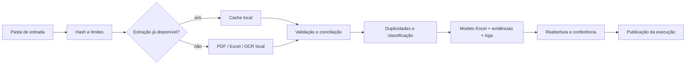

# Consolidação de extratos — case Goener

Automação em Python que lê uma pasta com PDFs, planilhas e imagens, extrai os saldos e gera o consolidado no modelo fornecido. A execução também confere as movimentações e registra o que precisa de revisão.

Os arquivos deste repositório são fictícios e pertencem ao case técnico. No modo padrão, o programa funciona sem chat, chave de API ou preenchimento manual de saldos. A análise por IA é opcional e vem desligada.

## Para quem vai usar

### O que a automação entrega

| Arquivo de saída | Para que serve |
| --- | --- |
| `consolidado.xlsx` | Uma linha por arquivo de entrada, nas oito colunas do modelo. |
| `relatorio.html` | Consulta local com filtro por status e evidência de cada arquivo. Abra no navegador. |
| `execucao.log` | Registro legível do processamento e das ocorrências. |
| `execucao.jsonl` | O mesmo acompanhamento em eventos estruturados. |
| `evidencias.json` | Dados extraídos, localização do saldo, confiança do OCR e conciliação. |
| `resumo.json` | Quantidades, duração, versão e saldo aprovado. |
| `manifesto.json` | Hashes dos arquivos de entrada, modelo e entregáveis para conferir integridade. |

### Como executar no Windows

Pré-requisito: **Python 3.12** instalado. Python 3.11 e 3.13 também são aceitos pelo projeto; a validação principal usa 3.12. Internet é necessária na instalação das dependências. Depois disso, o processamento é local.

1. Baixe ou clone o repositório.
2. Coloque os arquivos diretamente em `extratos/`.
3. Abra o PowerShell na pasta do projeto e execute:

```powershell
.\executar.ps1
```

Na primeira vez, o script cria `.venv`, instala as versões fixadas e executa o fluxo inteiro. Nas próximas, reaproveita o ambiente. Não é preciso abrir o Excel, separar PDFs ou informar os valores.

Se a política do computador não permitir scripts PowerShell, use os comandos Python abaixo, sem mudar as políticas do sistema:

```powershell
python -m venv .venv
.\.venv\Scripts\python.exe -m pip install -r requirements-lock.txt
.\.venv\Scripts\python.exe -m pip install -e . --no-deps
.\.venv\Scripts\python.exe -m goener --config config.toml
```

O terminal informa a pasta da execução em `outputs/`. `outputs/latest.json` aponta para a última publicação concluída. As execuções anteriores ficam preservadas.

### Como interpretar a planilha

| Status | Significado | Ação sugerida |
| --- | --- | --- |
| **ok** | Campos essenciais extraídos e verificações sem ressalvas. | Usar no fechamento da competência. |
| **revisar** | Há um valor extraído, mas uma regra encontrou uma ressalva. | Ler a observação e conferir a origem. |
| **falhou** | Não foi possível obter dados essenciais, o documento é inválido ou o processamento foi cancelado. | Solicitar o arquivo correto ou reprocessar após resolver a causa. |

Saldo negativo é válido. Um saldo não é trocado por outro para fazer a conta fechar. Valores com ressalvas permanecem na planilha, mas ficam fora do **saldo aprovado** exibido no relatório.

### A duplicidade do download

`EXT_102026_LagoaAzul (1).pdf` é uma cópia exata de `EXT_102026_LagoaAzul.pdf`. O programa compara o conteúdo com SHA-256, mantém as duas linhas e identifica a cópia em `Observação`. A cópia não participa de somas de acompanhamento.

Isso é diferente de um **possível lançamento repetido dentro do extrato**: nesse caso, a automação sinaliza a semelhança para conferência e não apaga a movimentação.

### Trocar a competência ou a pasta

O case vem configurado para **outubro de 2026**. Para outro mês:

```powershell
.\executar.ps1 -Period 2026-11
```

Também é possível editar `config.toml`. Os caminhos são relativos a esse arquivo. Removendo a linha `period`, o comando Python usa o mês anterior na zona `America/Sao_Paulo`; o atalho PowerShell mantém seu parâmetro padrão do case, que pode ser alterado.

### O que acontece quando um arquivo dá problema

O lote continua, e o arquivo recebe sua própria linha com a causa. O processo não declara publicação concluída quando há falha de infraestrutura, como pasta inexistente, execução concorrente ou problema ao gravar a saída.

Os arquivos originais não são movidos, corrigidos ou apagados. Feche o consolidado se o seu programa de planilhas estiver bloqueando uma gravação de arquivos copiados manualmente.

## Para quem vai manter

### Fluxo



### Organização do código

```text
src/goener/
  config.py       # configuração e competência
  models.py       # contratos, moeda, conciliação e duplicidades
  readers.py      # leitores de Excel, PDF e imagem
  pipeline.py     # fluxo, terminal, checkpoint, lock e log
  reporting.py    # planilha no modelo e relatório local
  ai.py           # contrato JSON, chamada HTTP e política dos dois modos
  report.html     # apresentação do relatório, sem dependências externas
extratos/         # entradas fictícias do case
templates/        # modelo original
tests/            # testes de regras, leitores e operação
docs/             # premissas e decisões
scripts/          # execução em Linux e preparação da entrega
```

Os leitores retornam o mesmo contrato `Statement`. CLI e uma futura API podem chamar `pipeline.run(config)` sem duplicar as regras financeiras. Não há navegador automatizado: esses arquivos podem ser lidos diretamente, o que reduz dependências e pontos de falha.

### Leitura e validação

- **Excel:** identifica as duas estruturas do case pelos cabeçalhos, preserva contas como texto e lê os valores sem executar fórmulas. Fórmulas, macros e relacionamentos externos são rejeitados.
- **PDF:** usa texto e posições das colunas. O débito é interpretado pelo sufixo `D` ou pela coluna de débito. PDFs digitalizados usam OCR como alternativa; layouts novos podem exigir ajuste do leitor.
- **Imagem:** usa RapidOCR com modelos PP-OCRv4 em CPU, mantendo a posição dos textos. Quando um sinal monetário desaparece na primeira leitura, a região é relida ampliada. Se o sinal continuar incerto, o arquivo exige revisão.
- **Conciliação:** compara cada saldo com o anterior mais a movimentação e compara o saldo final declarado com o último saldo e com a soma do período. Cálculos usam `Decimal`, com centavos.
- **Duplicidades:** conteúdo igual é identificado por hash. Conteúdos diferentes para a mesma combinação banco/conta/período também exigem revisão. Lançamentos semelhantes são suspeitas, não exclusões automáticas.
- **Segurança dos dados:** documentos são tratados como dados. Texto do arquivo não vira comando nem fórmula na saída. O HTML escapa os textos recebidos. Há limites de tamanho, páginas, pixels e descompactação.

A confiança do OCR não garante acerto. A conciliação agrega uma verificação independente, mas também não prova a autenticidade do documento. Nenhum arquivo é enviado a uma API de IA.

### Runtime e retomada

`runtime/` é gerado e fica fora do Git:

- `logs/`: eventos com execução, arquivo, hash, tentativa, duração e resultado final;
- `extractions.sqlite3`: checkpoint das extrações, identificado por conteúdo, versão/código do leitor e opções relevantes;
- `execution.lock`: impede duas execuções no mesmo runtime;
- `STOP`: interruptor opcional entre arquivos.

Uma nova execução pode reaproveitar a extração. Competência, conciliação e duplicidade são verificadas novamente. Assim, o cache não reaproveita um `ok` de outro contexto. O programa confere se o arquivo mudou durante a leitura antes de salvar o checkpoint.

Os logs separam tentativas transitórias do resultado final. Para contar falhas de documentos, use os eventos `FILE_FINISHED` ou `resumo.json`, não a quantidade de linhas que contêm a palavra erro.

### Comandos de operação

```powershell
# Reextrair tudo, sem consultar ou preencher o cache
.\.venv\Scripts\python.exe -m goener --no-cache

# Desligar OCR; imagens continuam registradas, com falha explícita
.\.venv\Scripts\python.exe -m goener --no-ocr

# Gerar a entrega e retornar código 2 se houver ressalvas
.\.venv\Scripts\python.exe -m goener --strict

# Solicitar parada: o arquivo atual termina, os restantes ficam cancelados
New-Item -ItemType File -Path runtime\STOP -Force

# Retomar após a parada
Remove-Item -LiteralPath runtime\STOP
.\.venv\Scripts\python.exe -m goener
```

| Código de saída | Interpretação |
| --- | --- |
| `0` | Fluxo concluído e publicado. Pode conter ressalvas de documentos. |
| `1` | Erro de configuração ou infraestrutura. Conferir terminal e runtime. |
| `2` | Fluxo publicado em modo estrito, com `revisar` ou `falhou`. |
| `3` | STOP acionado; entrega parcial publicada com cancelamentos explícitos. |
| `130` | Interrupção pelo operador. Retomar com nova execução. |

Se um encerramento abrupto deixar o lock, confira o PID gravado e confirme que o processo não está mais ativo antes de remover `runtime/execution.lock`. O programa não remove esse bloqueio por conta própria.

### Testes e integração contínua

```powershell
.\.venv\Scripts\python.exe -m ruff check src tests scripts
.\.venv\Scripts\python.exe -m pytest --cov=goener --cov-report=term-missing
```

Para uma rodada rápida sem inferência OCR, acrescente `-m "not ocr"` ao pytest. A suíte completa lê os documentos reais do case e testa centavos, negativos, falhas, duplicidade, reprocessamento, parada, lock, competência, segurança da saída e publicação.

A integração contínua roda em Windows e Linux com Python 3.12, executa os testes e gera uma nova consolidação a partir de `extratos/`. As versões estão registradas em `requirements-lock.txt`. Commits separam estrutura, processamento, testes e entrega.

### Instalação em Linux

```sh
sh scripts/run.sh --period 2026-10
```

Para agendar, use o Agendador de Tarefas do Windows ou `cron` chamando o mesmo comando. Não foi criado um agendamento nesta máquina. No modo estrito, um agendador pode sinalizar ressalvas pelo código de saída sem deixar de gerar a planilha.

### Limites e evolução

Este projeto atende aos layouts fornecidos e rejeita ambiguidade essencial. Não substitui conciliação bancária com o razão contábil, não autentica extratos e não integra contas bancárias. A revisão das exceções é uma etapa financeira posterior; a geração do consolidado é automática.

Próximos passos, por prioridade:

1. **P1 — Cobertura de entrada:** cadastrar as contas esperadas por competência para detectar extratos ausentes.
2. **P2 — Novos layouts:** ampliar o conjunto de testes e leitores com documentos autorizados de outros bancos.
3. **P3 — Histórico em Power BI:** avaliar uma camada de acompanhamento após concluir a automação. Adiada por orientação do responsável pelo case.

### Análise assistida e custo

Existem três transportes configuráveis. `ai_provider = "openai"` usa a Responses API por HTTPS; pode gerar cobrança e exige `OPENAI_API_KEY` no ambiente. `ai_provider = "chatgpt"` usa o adaptador experimental de navegador com perfil próprio, sem reutilizar cookies privados de outro perfil. `ai_mode = "off"` mantém ambos desligados por padrão. Não houve chamada real à API sem chave.

Para usar Gemini, altere `ai_provider = "gemini"` e `ai_model = "gemini-3.8-flash"` em `config.toml`, configure `GEMINI_API_KEY` no ambiente e execute com um dos modos abaixo. Também é aceita `GOOGLE_API_KEY` quando a primeira não estiver definida. A chave segue apenas no cabeçalho HTTPS, sem aparecer na URL, planilha ou logs. Não salve a chave no código nem envie pelo chat.

O projeto da API pode ter Free Tier, sujeito ao modelo, região e cotas. O plano Google AI de estudante não garante uso gratuito da API: os benefícios da interface e o faturamento da API são separados. Confira o projeto no AI Studio antes de habilitar a integração; o programa não ativa faturamento nem troca automaticamente para um serviço pago. A configuração inicial da chave ocorre na implantação. Cada lote, depois disso, roda sem login ou confirmação manual.

```powershell
.\.venv\Scripts\python.exe -m goener --ai-mode consultivo
# Após validar os critérios com a gestão:
.\.venv\Scripts\python.exe -m goener --ai-mode automatico
```

A chamada Gemini usa `generateContent`, esquema JSON e validação local. São feitas até três tentativas por arquivo em erros transitórios; cotas esgotadas, bloqueio, resposta parcial ou contrato inválido são registrados como indisponibilidade. No modo automático o saldo fica retido. O limite de tentativas evita espera indefinida, mas a disponibilidade depende da cota do projeto. Os testes automatizados simulam o HTTP; a validação real depende de chave configurada.

`--ai-mode consultivo` acrescenta recomendação e justificativa à observação, preservando a seleção pelas regras. `--ai-mode automatico` permite que a IA retenha um arquivo dos totais; para incluir, ele também precisa passar nas verificações obrigatórias. Cópias, dados ausentes, outra competência e divergências não são liberados pela IA. Recusa, resposta incompleta ou JSON inválido mantêm o arquivo fora do total no modo automático. Os valores originais são preservados.

O contrato tem somente `decision` (`considerar`, `nao_considerar` ou `revisar`), `reason` e `evidence_codes`. Campos extras e evidências inventadas são rejeitados localmente. Modelo, versão das instruções, identificador da resposta e uso informado pela API ficam nas evidências. O modelo não recebe ferramentas para executar código.

O adaptador de navegador é um experimento, não uma alternativa homologada para o case autônomo. O teste em perfil novo parou na confirmação humana de acesso, antes do envio de mensagem. Essa dependência impede considerá-lo uma etapa autônoma e repetível. Ele permanece fora da execução padrão. O programa não remove verificações do serviço nem promete operação sem conta. A sessão pode expirar, e mudanças de interface exigem manutenção. Não há chamadas a endpoints HTTP privados do ChatGPT implementadas ou validadas.

O experimento de preparação assistida fica separado da entrega autônoma. Ele não é um passo exigido pelo pipeline padrão. Para investigá-lo fora da execução do case:

```powershell
.\.venv\Scripts\python.exe -m pip install "selenium==4.52.0"
.\.venv\Scripts\python.exe scripts\prepare_chatgpt.py
```

O operador faz login e eventuais confirmações pessoalmente e seleciona High/Alto. O perfil fica em `runtime/chatgpt-profile`, fora do Git e do pacote de entrega. Nunca compartilhe essa pasta. A preparação não comprova por si só o envio e a leitura de uma resposta: o teste completo precisa ser concluído antes de ativar o modo automático. Se o modo High não puder ser confirmado ou a resposta não cumprir o contrato, o resultado fica indisponível, sem liberação automática.

Uma sessão previamente autenticada pode ser um pré-requisito de implantação, mas sua validade não é garantida pelo robô. Usuário e senha em `.env` não eliminam desafios de acesso. O projeto não armazena essas credenciais nem contorna confirmações. Se a sessão deixar de ser utilizável, a IA não libera saldos e a ocorrência é registrada.

### Estimativa em horas

Não há estimativa financeira. O cenário inicial usa 8 minutos por arquivo: abrir/localizar (2), copiar os campos entre formatos (3), conferir (2), registrar e organizar (1). São hipóteses explícitas, não tempos medidos da equipe. A revisão das pendências usa 3 minutos por arquivo. Ambas as premissas são editáveis em `config.toml`.

Horas manuais estimadas = arquivos × minutos por arquivo ÷ 60. Horas assistidas estimadas = segundos medidos do robô ÷ 3600 + pendências × minutos de revisão ÷ 60. A diferença é capacidade estimada liberada, sem conversão em reais. Com 17 arquivos e 5 pendências, o cenário fica próximo de 2,01 horas liberadas por fechamento, dependendo da duração medida. Não há histórico de meses suficiente para afirmar uma tendência.

As decisões e os motivos estão em [docs/decisoes.md](docs/decisoes.md). A documentação de uma página fica no pacote `entrega/`.

## Referências técnicas

- [RapidOCR: uso e campos de saída](https://rapidai.github.io/RapidOCRDocs/main/en/install_usage/rapidocr/usage/)
- [openpyxl: leitura e gravação de planilhas](https://openpyxl.readthedocs.io/en/stable/tutorial.html)

- [Gemini: contrato HTTP oficial](https://ai.google.dev/api/generate-content)
- [Google AI: assinatura e API são serviços separados](https://aistudio.google.com/docs/google-ai-plans)
- [Gemini: cotas e faturamento](https://ai.google.dev/gemini-api/docs/billing)
