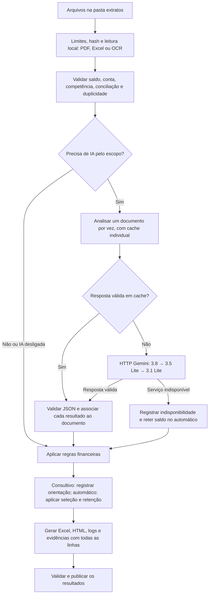

# Consolidação de extratos — Goener

Automação em Python: recebe uma pasta com PDFs, Excel e imagens, lê o saldo final de cada conta e gera a planilha no modelo do case. O fluxo inteiro roda sem copiar valores manualmente.

## Para usar

1. Instale Python 3.12 e baixe este repositório.
2. Coloque os documentos em `extratos/`.
3. Abra o PowerShell nesta pasta e execute:

```powershell
.\executar.ps1
```

O script usa o Python 3.12 instalado no Windows (`py -3.12`), confere as dependências e instala as que faltarem nas versões fixadas. Não cria ambiente virtual nem exige ativação. As bibliotecas ficam na instalação selecionada do Python e são compartilhadas com outros projetos que a utilizem. A instalação e o download inicial dos modelos OCR precisam de internet. Com a IA desligada, a leitura dos documentos acontece localmente.

O terminal mostra a pasta do resultado. `.local/outputs/latest.json` aponta para a última execução concluída. Cada execução preserva suas evidências. A pasta `entrega/` contém somente os três arquivos para envio: `goener_automacao.zip`, `consolidado.xlsx` e `documentacao_1_pagina.pdf`. O relatório, os logs e as evidências permanecem no resultado da execução e dentro do ZIP, em `resultado/`.

| Arquivo gerado | Para que serve |
| --- | --- |
| `consolidado.xlsx` | Uma linha por documento nas oito colunas do modelo. |
| `relatorio.html` | Conferência no navegador, com busca, filtros e orientações. |
| `execucao.log` | O que foi processado e o que apresentou problema. |
| `execucao.jsonl` | Eventos de execução para integração e auditoria. |
| `evidencias.json` | Dados extraídos, origem do saldo, conciliação e análise da IA. |
| `resumo.json` | Quantidades, duração medida e saldo aprovado. |
| `manifesto.json` | Hashes para conferir a integridade dos arquivos. |

### Entender os resultados

- **ok:** campos essenciais encontrados e verificações sem ressalvas.
- **revisar:** há uma pendência descrita em Observação; conferir antes de considerar o saldo.
- **falhou:** documento inválido ou dados essenciais indisponíveis.

Nenhum saldo é corrigido para fazer a conta fechar. Os originais são preservados. Valores com ressalvas permanecem na planilha, mas ficam fora do total aprovado.

**Duplicidade registrada:** `EXT_102026_LagoaAzul (1).pdf` é uma cópia exata de `EXT_102026_LagoaAzul.pdf`. A comparação usa SHA-256; ambas as linhas ficam na planilha, e a cópia não entra nas somas. Possíveis lançamentos repetidos dentro de um extrato são sinalizados para conferência, sem apagar movimentações.

O cenário de referência tem 17 arquivos: 12 ok, 4 revisar e 1 falhou. O saldo aprovado pelas regras é R$ 4.114.372,29. O aviso de agência não é um extrato; há também divergência de conciliação e uma imagem de setembro em um lote de outubro.

### Conferência rápida no Excel e no HTML

A aba `Consolidado` mantém as oito colunas do modelo, agora como tabela do Excel (`Extratos`), com filtro e cabeçalho congelado. A nova aba `Resumo` usa fórmulas para calcular saldo considerado, quantidades por status e arquivos fora da competência. A aba original `Instruções` é preservada. Status usa cor e texto; Observação separa pendência, onde conferir, referência e análise da IA. Os saldos continuam numéricos e os originais são preservados. No `Resumo`, a célula amarela B3 escolhe o mês (AAAA-MM). O total soma somente linhas com status `ok` desse mês; as contagens abrangem a tabela completa, independentemente dos filtros visuais.

Para corrigir ou acrescentar dados, edite a tabela em `Consolidado`; para remover um registro, use **Excluir linhas da tabela**. O resumo recalcula no Excel, inclusive ao expandir a tabela. O status tem lista de opções e cores que acompanham a alteração. Marcar `ok` é uma liberação manual sob responsabilidade de quem revisa: as fórmulas não repetem hash, OCR, conciliação ou IA. As observações registram a execução original. Salve uma cópia revisada; o HTML não acompanha edições do Excel e uma nova execução do robô não importa essas alterações.

O relatório abre na fila de atenção e mostra o motivo antes de expandir o arquivo. Há filtros para recomendações concluídas e indisponibilidades da IA. Dentro de cada item: regras → IA → onde conferir → próximo passo. O botão abre o documento de origem; em PDF, inclui a página quando identificada. A origem da indicação fica explícita: extração local ou sugestão da IA. Quando a localização não é conhecida, o relatório pede conferência do documento completo, sem inventar página.

Os extratos originais não são alterados. A coluna Observação e o HTML informam a medida aplicada: incluir saldo, reter valor, excluir cópia do total, excluir competência diferente ou registrar documento sem saldo. A geração termina com todas as linhas e ressalvas, sem esperar aprovação humana. Revisão financeira posterior é necessária somente para resolver informações que a fonte não permite determinar, como solicitar o extrato correto ou confirmar uma divergência bancária.

O formato original não é alterado para satisfazer a IA. Um alerta consultivo pode exigir atenção mesmo quando as regras passaram, mas não muda automaticamente o total. As indicações geradas pelo modelo precisam ser confirmadas no original. Os links de origem do relatório são ajustados no ZIP para os arquivos do case que acompanham o pacote.

### Configuração e comandos

Edite `config.toml` para trocar pasta, competência, limites e modo de IA. Os caminhos são relativos ao arquivo de configuração. O case usa outubro de 2026; sem `period`, o comando Python usa o mês anterior em São Paulo.

```powershell
.\executar.ps1 -Period 2026-11
.\executar.ps1 -NoCache       # reextrair todos os documentos
.\executar.ps1 -NoOCR         # registrar imagens sem extrair por OCR
.\executar.ps1 -Strict        # avisar pelo código de saída quando houver pendências
.\executar.ps1 -Validate      # executar os testes antes do lote
```

### Rodar diretamente pelo Python nesta máquina

Com o Python 3.12 instalado, prepare as dependências uma vez e execute:

```powershell
cd C:\Users\felip\OneDrive\Desktop\goener
py -3.12 -m pip install -r requirements-lock.txt
py -3.12 -m goener
```

A chave é lida automaticamente do `.env` ao lado do `config.toml`. `-m goener` executa a entrada Python do projeto (`goener/__main__.py`) e lê `config.toml`. Não execute `ai.py` ou `pipeline.py` isoladamente: são módulos internos. Para usar somente as regras locais:

```powershell
py -3.12 -m goener --ai-mode off
```

Nas próximas execuções basta `py -3.12 -m goener` no mesmo terminal. O atalho `executar.ps1` confere as dependências; o próprio Python lê a chave do `.env`. Para outro executável compatível: `.\executar.ps1 -Python "C:\caminho\python.exe"`. No Linux: `sh executar.sh --period 2026-10`, usando Python 3.11 a 3.13 e uma instalação com permissão para instalar dependências; `PYTHON=python3.12 sh executar.sh` permite escolher a versão.

## Para manter

A estrutura usa cinco módulos de trabalho, sem camadas de serviços, repositórios ou controladores:

```text
goener/
  core.py           configuração, dados e regras financeiras
  readers.py        leitura de PDF, Excel e OCR
  ai.py             HTTP com OpenAI ou Gemini e contrato JSON
  reporting.py      geração da planilha e do relatório
  pipeline.py       execução, cache, logs e linha de comando
  report.html       apresentação do relatório
  entrega.py        empacotamento dos três arquivos para envio
extratos/           entradas fictícias do case
entrega/            apenas ZIP, planilha e documentação de uma página
tests/             testes automatizados
modelo.xlsx         modelo original fornecido
config.toml         parâmetros da execução
requirements-lock.txt  versões fixadas das dependências
```

`__init__.py` e `__main__.py` permitem executar `python -m goener`. `.github/` contém a integração contínua. `.local/` guarda saídas, checkpoints, logs e arquivos locais anteriores; essa pasta não vai para o Git nem para o ZIP. O histórico das versões entregues continua disponível no Git.

### Fluxo e escolhas técnicas



O fluxo termina sem aprovação manual entre etapas. O escopo padrão envia apenas exceções. A IA complementa as regras; não remove bloqueios obrigatórios nem altera os documentos originais.

- `Decimal` preserva centavos e aceita saldos negativos.
- A conciliação compara saldo inicial + movimentações com o saldo final declarado.
- OCR roda em CPU; confiança baixa e ambiguidade viram ressalvas.
- SQLite reaproveita extrações por conteúdo, código do leitor e opções. As regras de negócio são reaplicadas em cada execução.
- O processamento é **sequencial**. Não há paralelismo entre arquivos; isso mantém a operação simples e evita concorrência na escrita.
- Um lock impede duas execuções no mesmo runtime. As saídas são montadas em uma pasta temporária e publicadas após validação.
- Um documento com erro não derruba os demais. Falha de configuração ou infraestrutura não é declarada como conclusão bem-sucedida.
- Logs registram duração, tentativas e resultados finais. Conte documentos pelo resumo ou pelos eventos `FILE_FINISHED`, sem contar mensagens de tentativa como falhas definitivas.

Para solicitar parada entre arquivos, crie `.local/runtime/STOP`. O arquivo em andamento termina e os restantes são registrados como cancelados. Remova esse arquivo para retomar com uma nova execução. Se um encerramento abrupto deixar `execution.lock`, confira se o PID já terminou antes de remover o lock.

Códigos de saída: `0` fluxo publicado; `1` configuração/infraestrutura; `2` pendências em modo estrito; `3` parada solicitada; `130` interrupção pelo operador.

### IA opcional

O padrão é `ai_mode = "automatico"` e `ai_scope = "excecoes"`. O Python lê todos os documentos, valida campos, competência, duplicidade e conciliação. Só os que ficam como revisar/falhou seguem para o Gemini. Os regulares são concluídos pelas regras, com registro de IA dispensada. A IA exige `GEMINI_API_KEY` no ambiente; sem chave ou serviço disponível, as pendências continuam identificadas, sem impedir a publicação do lote. A configuração inicial da chave ocorre na implantação, sem login ou confirmação durante os lotes.

```powershell
.\executar.ps1                              # automático somente nas exceções
.\executar.ps1 -AiMode off                  # apenas regras locais
.\executar.ps1 -AiMode consultivo -AiScope todos  # conferência adicional de todos
.\executar.ps1 -AiMode automatico            # decisão aplicada às exceções, sem superar bloqueios
```

**Consultivo:** registra recomendação, justificativa e indicação de onde conferir, preservando os totais pelas regras. **Automático:** a IA pode reter o saldo dos arquivos escolhidos pelo escopo; para incluí-los, eles também precisam passar nas verificações obrigatórias. Com escopo excecoes, os arquivos regulares não dependem de uma resposta da IA. Com todos, cada arquivo precisa da decisão válida para entrar no total automático. Duplicidade, competência incorreta, campos ausentes e divergências não são liberados pela IA.

O contrato básico contém `decision` (`considerar`, `nao_considerar` ou `revisar`), `reason` e `evidence_codes`. No modo completo do Gemini, o JSON também exige `source_check`: banco, conta, competência, saldo, legibilidade, localização e um trecho de evidência do original. O Python valida o contrato e compara essa leitura com a extração local. Campos extras e códigos de evidência inventados são rejeitados. Uma citação gerada pela IA não comprova, sozinha, que a leitura está correta.

O Gemini recebe as premissas do fechamento, exemplos de decisão, o resultado das regras, todas as movimentações extraídas, texto/OCR, confiança crítica e evidência do saldo disponíveis. As coordenadas de todos os tokens OCR ficam na auditoria local, sem repetir essa matriz inteira na requisição. As instruções ficam versionadas em `goener/ai.py` (`PROMPT_VERSION = "2"`), sem agente persistente ou treinamento dos pesos. Não há ferramentas para executar código ou seguir links. Documentos, fórmulas e OCR são tratados como dados não confiáveis.

| `ai_document_mode` | O que é enviado ao Gemini |
| --- | --- |
| `completo` | PDF original inteiro ou imagem original; para Excel, células preenchidas de todas as abas, com aba e coordenada. Inclui a extração local para comparação. |
| `dados` | Somente dados, movimentações e evidências extraídos pelo Python/OCR. Não exige uma leitura independente do original. |

O modo completo evita depender da primeira aba que o serviço lê ao receber Excel nativamente. Fórmulas seguem como texto e nunca são executadas pelo robô. Gráficos, imagens incorporadas e formatação do Excel não são enviados nessa conversão. PDFs e imagens seguem por `inlineData`, sem criar arquivos remotos pela Files API. Ao ativar a IA, o conteúdo escolhido é transmitido ao provedor.

### OCR, Base64 e leitura multimodal

São três etapas diferentes. O RapidOCR faz a leitura local de imagens e páginas de PDF sem texto utilizável. Usa PP-OCRv4 Mobile com ONNX Runtime em CPU; retorna texto, confiança e posição dos trechos. Assim, o robô consegue registrar baixa confiança e apontar a origem da leitura. PDFs com texto selecionável são lidos diretamente pelo pdfplumber; Excel é lido pelo openpyxl. Não há instalação de executável Tesseract. Não foi feito um benchmark para afirmar que RapidOCR é sempre mais rápido ou preciso que Tesseract.

No modo completo, o Python também envia o PDF ou a imagem original ao Gemini. Os bytes são codificados em **Base64** no campo `inlineData`, dentro do corpo JSON do POST HTTPS. O campo `mimeType` informa `application/pdf`, `image/png` ou `image/jpeg`. O serviço reconstrói o arquivo a partir dessa codificação. Base64 é um formato de transporte: não é OCR, criptografia, compactação nem um recurso que, sozinho, faz a IA compreender o conteúdo.

O modelo **multimodal** é que consegue analisar texto e elementos visuais. Ele recebe o documento original junto com os resultados locais e as premissas. Assim, pode comparar uma leitura do original com a extração do Python, em vez de depender apenas do OCR. Essa conferência não garante acerto nem altera os originais.

### Como o Excel chega ao Gemini: exemplo simples

Imagine a aba `Extrato` com estas células (o saldo é numérico no Excel, apenas exibido com vírgula):

| Linha | Coluna A | Coluna B |
| --- | --- | --- |
| 1 | Banco | Banco Aurora |
| 2 | Saldo final | 1.234,56 |

A parte textual enviada nessa solicitação contém:

```json
{
  "source_workbook": [
    {
      "sheet": "Extrato",
      "visibility": "visible",
      "cells": [
        {"cell": "A1", "value": "Banco"},
        {"cell": "B1", "value": "Banco Aurora"},
        {"cell": "A2", "value": "Saldo final"},
        {"cell": "B2", "value": "1234.56"}
      ]
    }
  ]
}
```

É um mapa: nome da aba, endereço da célula e conteúdo. Na serialização atual, os conteúdos viram strings; isso não muda os números guardados no Excel de origem. O nome da célula permite indicar, por exemplo, “aba Extrato, célula B2”. Todas as abas e suas células preenchidas são incluídas, respeitando os limites abaixo. Fórmulas são enviadas literalmente como texto, sem execução. Essa representação não inclui gráficos, imagens incorporadas ou formatação. Junto desse mapa seguem o contexto das regras e os valores extraídos para comparação. Não se usa OCR para ler as células do Excel.

### Dois controles independentes: enxergar e raciocinar

| Controle | Configuração atual | O que significa |
| --- | --- | --- |
| Resolução da mídia | `MEDIA_RESOLUTION_HIGH` | Permite mais detalhes visuais para PDFs e imagens enviados ao Gemini. |
| Raciocínio | `ai_thinking_level = "high"` | Solicita maior esforço de raciocínio ao modelo selecionado: 3.8, 3.5 ou 3.1. |
| OCR local | PP-OCRv4 Mobile; confiança mínima 0,90 | Outra etapa, executada localmente. Não possui o nível low/high do Gemini. |

A analogia é uma lupa e o tempo dedicado à conferência: resolução é o detalhe que se consegue enxergar; thinking é o esforço para analisar o que foi visto. As configurações são independentes. Antes desta mudança, a mídia já estava em HIGH e o raciocínio estava em LOW; agora ambos estão em HIGH.

Segundo a [documentação de thinking](https://aistudio.google.com/docs/thinking), os três modelos suportam high, e tokens de raciocínio entram no consumo informado pela API. High pode usar mais tokens e levar mais tempo; não existe garantia de obter o mesmo consumo de low. A [resolução de mídia](https://aistudio.google.com/docs/media-resolution) também controla a alocação de tokens de entrada visual. A mudança para high foi autorizada aceitando maior consumo. O programa não ativa faturamento; no Free Tier continua sujeito às cotas, e em projeto pago valem as tarifas do provedor.

As evidências guardam `thinking_level` e o `usageMetadata` retornado pela chamada em `ai.usage`, incluindo `promptTokenCount`, `candidatesTokenCount`, `thoughtsTokenCount` e `totalTokenCount` quando fornecidos. O total não deve ser reconstruído supondo que existam somente tokens visíveis. A troca low/high altera a chave de cache: uma resposta antiga em low não é reaproveitada como se fosse high. Um único teste não demonstra superioridade nem uma proporção fixa de consumo.

Os limites são explícitos: até 8 MB por original, limite de páginas/pixels do projeto, até 30 mil células examinadas no Excel e 100 mil caracteres por contexto/texto de planilha. Se exceder, a análise fica indisponível; não há corte silencioso nem indicação falsa de documento completo. Antes de enviar, o hash deve coincidir com a extração; links simbólicos e caminhos fora da entrada são bloqueados.

A IA nunca sobrescreve banco, conta, período ou saldo do consolidado. No consultivo, diferenças da leitura independente ficam na observação e nas evidências, preservando a seleção pelas regras. No automático, uma diferença ou falta de evidência bloqueia a inclusão mesmo que o modelo recomende considerar.

Gemini usa HTTPS `generateContent`, esquema JSON e chave no cabeçalho. Também é aceita `GOOGLE_API_KEY`. OpenAI usa a Responses API: altere o provedor para `openai`, escolha o modelo e configure `OPENAI_API_KEY`. Não há troca automática entre provedores. No Gemini, até três tentativas por modelo atendem HTTP 500/502/503/504, timeout e falha de rede, com espera crescente e variação aleatória. Com failover ativo, 429 segue direto ao próximo modelo; sem alternativos, o retry respeita a cota e a espera. São considerados `Retry-After` numérico limitado a um dia e o `RetryInfo` do provedor. Erros permanentes não são repetidos. Bloqueio, cota esgotada, resposta parcial ou JSON inválido retêm o saldo no modo automático.

Parâmetros editáveis: `ai_thinking_level = "high"` (compartilhado pelos três modelos; também aceita low/medium), `ai_timeout_seconds = 60`, `ai_max_attempts = 3` e `ai_batch_timeout_seconds = 300`. O timeout de rede é por operação; não é uma garantia rígida de duração total. O orçamento impede novas tentativas após o prazo e reduz o timeout ao tempo restante. No modo individual, três análises externas com falha seguida abrem o circuito. No modo agrupado, cada grupo compartilha o resultado da chamada, respeitando orçamento e bloqueios de cota persistidos. O arquivo STOP é verificado antes dos próximos arquivos e tentativas.

Os eventos `AI_RETRY`, `AI_BATCH_STARTED`, `AI_BATCH_FINISHED`, `AI_SKIPPED`, `AI_STARTED`, `AI_THROTTLED`, `AI_CACHE_HIT`, `AI_ATTEMPT` e `AI_FINISHED` registram arquivo, duração, tentativa, código HTTP, status seguro do provedor e resultado. Corpos HTTP, documentos e chaves não são copiados para os logs. As evidências registram versão das instruções, hash do contexto, tipo/completude da fonte, resposta validada e discrepâncias. `ai_summary` no resumo separa tentativas HTTP, decisões válidas, arquivos indisponíveis e diferenças encontradas. Sucesso HTTP não equivale a uma análise aprovada.

Não salve chaves no código ou nos logs. A assinatura Google AI de estudante e o faturamento da API são separados. Verifique se o projeto está no Free Tier e tem cota. O programa não ativa faturamento. O experimento de navegador ChatGPT foi retirado para reduzir dependências e porque exigia confirmação humana.

**Histórico da versão anterior (antes da melhoria multimodal):** o lote consultivo de 17 arquivos levou 603,661 segundos; 2 análises retornaram decisões válidas e 15 ficaram indisponíveis (8 timeouts e 7 erros classificados como `ValueError`). Os totais pelas regras foram preservados. Portanto, a conectividade e o contrato tiveram respostas reais válidas, mas a IA externa **ainda não está homologada para decidir o lote inteiro**. Naquela versão, ela ficava desligada por padrão. A configuração atual aplica medidas automáticas apenas nas exceções, por solicitação do responsável pelo case. Os detalhes deste ensaio estão no histórico local da execução `20261114T103109Z_a649ee0e`; os tipos de erro registrados não permitem atribuir todos os casos a uma causa específica.

**Ensaio multimodal desta versão:** três documentos do case (Excel, PDF e PNG), em modo consultivo, foram processados em 127,685 segundos, incluindo a extração local. Para essa rodada foram usados 30 segundos por operação, duas tentativas e orçamento de 120 segundos para IA. Nenhum retornou uma decisão válida: ocorreram HTTP 503 (`UNAVAILABLE`), HTTP 429 (`RESOURCE_EXHAUSTED`) e timeouts, agora discriminados por tentativa. A validação de payload, integridade, todas as abas e bloqueios foi feita por testes automatizados; a leitura multimodal real ainda não está homologada. A evidência local está em `.local/validacao_multimodal/20261114T141520Z_1981ae30/`. Nenhuma nova cobrança foi habilitada.

**Ensaio do roteamento seletivo:** o lote de 17 documentos passou pelas regras; 12 dispensaram a IA e 5 foram classificados como exceção. Houve 3 tentativas HTTP, todas com 429 (`RESOURCE_EXHAUSTED`); o controle de falhas pausou os dois arquivos restantes. O resultado financeiro permaneceu em 12 ok, 4 revisar e 1 falhou. O ensaio usou uma tentativa, 15 segundos por operação e 60 segundos de orçamento para IA, sem alterar os parâmetros padrão de operação. Nenhuma recomendação foi apresentada como concluída quando o serviço não respondeu.

O ajuste supervisionado deve usar exemplos classificados pela equipe e avaliação em casos separados. Ajustar instruções não é treinar os pesos do modelo. O modo consultivo continua disponível para avaliar novas políticas. As ações automáticas atuais são limitadas à seleção e retenção dos valores no consolidado; ampliar a política exige avaliação dos casos e critérios definidos com a gestão.

### Causa dos erros de API e controle de consumo

O painel do projeto Free Tier mostrou para Gemini 3.8 Flash: 5 RPM, 20 RPD e 250 mil TPM. Os picos observados foram 7 RPM e 33 RPD, ultrapassando os limites. Os testes e retries anteriores contribuíram para esse consumo; repetir em poucos segundos não recupera a cota diária. Uma chamada de diagnóstico também retornou 503 com mensagem explícita de alta demanda do modelo.

Na validação individual foi usado `gemini-3.1-flash-lite`: o painel atribuiu 15 RPM, 500 RPD e 250 mil TPM a esse modelo no mesmo projeto gratuito. Ele suporta PDF, imagem e JSON estruturado. Naquela rodada foi usado raciocínio low para reduzir latência; a configuração atual usa high. As contas financeiras continuam no Python. Nenhum faturamento foi habilitado e não há rotação de contas, chaves ou projetos.

O arquivo local `gemini.sqlite3` guarda análises válidas, tentativas e bloqueios. A resposta é reutilizada por até 30 dias somente quando modelo, instruções, esquema, conteúdo da requisição e documentos forem iguais. Uma troca de período, evidências, instruções ou modelo invalida a chave. Respostas inválidas não entram no cache. A política consultiva/automática é reaplicada no momento de usar a resposta. `--no-cache` força uma nova análise, respeitando os limites.

Os limites locais são 12 RPM e 450 RPD, deixando margem abaixo da cota observada. Cada tentativa é contada antes do envio, inclusive retries. A reserva e o espaçamento persistem entre execuções; reiniciar o robô não zera os contadores. Erro de cota diária interrompe novas tentativas e registra o horário da próxima janela em vez de insistir. Os limites por dia usam a meia-noite do Pacífico, conforme a API. Esses contadores não enxergam consumo por outros programas; o retorno do Google continua sendo a autoridade e também é tratado.

A disponibilidade externa não é garantida. Quando uma análise não puder ser concluída, o consolidado é entregue com a retenção e a ressalva correspondentes. Em uma nova execução, extrações e análises válidas são reaproveitadas; os grupos que ainda necessitam de análise demandam novas chamadas. Isso mantém a geração automática sem inventar aprovação ou corrigir o saldo de um extrato por inferência.

**Validação real após a correção:** com Gemini 3.1 Flash-Lite e o modo automático padrão, as cinco exceções do lote receberam respostas JSON válidas, usando os documentos originais. Foram seis tentativas HTTP (um timeout seguido de recuperação), com zero análises indisponíveis no resultado final. O processamento levou 124,315 segundos nesta máquina, incluindo extração local. As leituras de saldo, conta e competência dos quatro extratos conferiram com os documentos; o comunicado foi reconhecido como não sendo extrato. A cópia foi excluída dos totais pela regra determinística mesmo com a recomendação de revisão da IA. Os 17 arquivos permaneceram registrados e o saldo incluído continuou em R$ 4.114.372,29.

**Reexecução validada:** o mesmo lote reaproveitou as cinco análises válidas, com zero novas chamadas HTTP, zero análises indisponíveis e 0,225 segundo de processamento medido (instalação/inicialização do Python não entram nessa duração). Os 12 arquivos regulares continuaram dispensando IA. Os hashes dos 17 documentos de entrada permaneceram inalterados.

### Chave em arquivo `.env` e pacote privado

O projeto carrega automaticamente o `.env` que estiver **na mesma pasta de `config.toml`**, tanto pelo comando Python quanto pelo atalho. Não procura arquivos em outras pastas. Os valores do `.env` têm prioridade sobre variáveis já presentes no processo. O atalho não busca a chave cadastrada no Windows nem utiliza sessão de navegador. As referências `${VAR}` no arquivo não são expandidas.

Copie `.env.example` como `.env` e preencha:

```dotenv
GEMINI_API_KEY=sua_chave_aqui
```

Na máquina de quem recebe o projeto, execute na pasta extraída:

```powershell
py -3.12 -m pip install -r requirements-lock.txt
py -3.12 -m goener
```

Instalar dependências prepara a leitura do `.env`; o segundo comando inicia a automação. Não é necessário cadastrar variável do Windows quando o `.env` está preenchido. Use Python 3.12 instalado. Sem chave válida ou cota disponível, o fluxo mantém as regras locais e registra as análises indisponíveis.

O Git ignora `.env`; somente `.env.example`, vazio, é versionado. O empacotamento padrão também exclui a credencial. Por solicitação do responsável, é possível montar um **ZIP privado com a chave**:

```powershell
py -3.12 -m goener.entrega --include-env
```

Nesse caso, o ZIP contém `goener-case/.env` ao lado do `config.toml`. Quem receber o arquivo poderá utilizar a chave e consumir sua cota. Envie esse pacote somente aos avaliadores e revogue a chave após a avaliação. Não publique esse ZIP como release ou anexo público. Chaves e conteúdo do `.env` não são registrados nos logs.

### Chamadas individuais e agrupamento opcional

O padrão agora é **um documento por solicitação HTTP** (`ai_batch_size = 1`), em sequência, sem paralelismo. Cada solicitação envia o contexto JSON e o documento daquele arquivo; a resposta é validada e salva em cache individualmente. Os 12 arquivos sem pendências continuam dispensando IA.

Se o 3.8 concluir os arquivos 1, 2 e 3 e esgotar a cota no arquivo 4, o 3.5 tenta somente o arquivo 4. O arquivo 5 também pode seguir ao 3.5, pulando o 3.8 enquanto estiver bloqueado. Os três resultados concluídos não são reenviados nessa execução. Se o 3.5 também ficar indisponível, o próximo é o 3.1. Caches anteriores feitos em grupo não são convertidos automaticamente em respostas individuais.

**Retry e failover:** cada modelo tem até `ai_max_attempts = 3` tentativas (a inicial e até duas repetições) para HTTP 500/502/503/504, timeout ou falha de rede, com espera crescente e variação aleatória. Persistindo o erro, passa ao próximo modelo. Com alternativos ativos, HTTP 429 alterna diretamente e registra o bloqueio, sem repetir no mesmo modelo. HTTP 400 indica requisição inválida ou pré-condição e não é tratado como falta de tokens; 401/403 também não são repetidos nem contornados por outro modelo. As tentativas respeitam o orçamento de tempo e as cotas locais; o máximo não é uma promessa de executar todas quando esses limites impedirem. As solicitações individuais preservam os arquivos concluídos e consomem mais chamadas que um agrupamento bem-sucedido.

**Validação individual:** o lote de 17 arquivos concluiu as cinco exceções com respostas válidas do 3.5, em solicitações separadas, após pular o 3.8 por bloqueio diário. Nenhuma análise ficou indisponível. Os testes simulam três respostas concluídas no 3.8 e o processamento somente dos dois arquivos restantes no 3.5.

**Opcional:** configure `ai_batch_size = 5` para enviar até cinco documentos em uma solicitação HTTP. Cada documento e seu anexo têm um ID próprio; a resposta deve devolver exatamente um resultado por ID. O robô rejeita IDs desconhecidos, repetidos ou ausentes e evidências de outro documento. Uma falha exige reenviar o grupo completo ao alternativo.

Este é um agrupamento no `generateContent` síncrono, sem serviço adicional ou fila assíncrona. Os grupos respeitam até 100 mil caracteres de contexto e 16 MiB de anexos serializados, além dos limites individuais. Se ultrapassar, o robô divide em mais solicitações; não recorta documentos. Configure `ai_batch_size = 1` para análises individuais; o máximo permitido é 10.

**Uma chamada não significa consumo de um documento:** os tokens de todos os documentos e respostas continuam contando. Retentativas e failover podem gerar chamadas adicionais. O resumo conta cada tentativa HTTP compartilhada apenas uma vez, sem multiplicá-la pelo número de resultados. O cache pertence ao grupo completo: alterar um documento ou a composição do grupo exige nova análise desse grupo. Se o JSON do grupo for inválido, nenhuma decisão desse grupo é aplicada.

**Validação real do agrupamento (versão 1.5.0):** as cinco exceções, com PDF e imagem originais, receberam cinco decisões válidas em **uma tentativa HTTP** ao Gemini 3.1 Flash-Lite. O 3.8 foi pulado pelo bloqueio diário já registrado. Zero análises indisponíveis e zero divergências nos campos comparáveis dos quatro extratos. O comunicado foi rejeitado como documento sem saldo. O lote completo levou 91,195 segundos, incluindo reextração local; manteve 17 linhas, 12 ok, 4 revisar, 1 falhou e saldo aprovado de R$ 4.114.372,29. O ID de resposta compartilhado comprova o agrupamento; IDs dos itens preservam a associação individual.

### Failover de modelos

A ordem padrão é `gemini-3.8-flash` → `gemini-3.5-flash-lite` → `gemini-3.1-flash-lite`. Ela é definida por `ai_model` e `ai_fallback_models` em `config.toml`. A prioridade segue a preferência definida para o case; não representa um comparativo comprovado de qualidade entre modelos. Uma lista vazia desliga a alternância. Não há troca automática de provedor, conta, chave ou projeto.

O principal é tentado primeiro, inclusive verificando o cache daquele modelo. Cota esgotada ou espera de cota superior a cinco segundos permite seguir para o próximo. Também há alternância para timeout, falha de rede, indisponibilidade HTTP 5xx e modelo não encontrado (404). Um modelo que falha por comunicação fica em pausa por 60 segundos; bloqueios de cota diária respeitam a janela diária. Cache válido continua podendo ser usado durante a pausa.

Com ou sem alternativos, `ai_max_attempts` limita as tentativas por modelo em erros transitórios, dentro do orçamento compartilhado do lote. Com failover ativo, cota 429 é encaminhada diretamente ao próximo modelo. Os limites locais continuam valendo por modelo: para o 3.8 há o teto observado de 5 RPM/20 RPD; para os dois Lite, 15 RPM/500 RPD. O limite configurado pode ser mais restritivo.

Uma decisão válida encerra a busca, inclusive quando é revisar ou não considerar. Falhas de contrato JSON, bloqueios de segurança, autenticação/permissão e HTTP 400 não são contornados por outra resposta de modelo. Os bloqueios financeiros obrigatórios são aplicados pelo Python em todos os casos. Se nenhum modelo responder, o saldo segue retido com ressalva.

A prioridade é preservada: quando o principal voltar a ficar disponível, pode gerar uma nova análise mesmo se existir uma resposta anterior de um alternativo. O cache é específico de cada modelo. `AI_FAILOVER` registra motivo e troca; `AI_MODEL_SELECTED` registra a escolha final. As evidências guardam principal solicitado, modelo selecionado, modelos percorridos e tentativas HTTP de toda a cadeia. Planilha e HTML mostram o modelo utilizado e se houve failover.

**Validação do failover:** no lote real de 17 arquivos, as cinco exceções percorreram 3.8 (bloqueio de cota diária já registrado) → 3.1 Flash-Lite (análise válida em cache), sem novas chamadas HTTP e sem análises indisponíveis. O terceiro modelo, 3.5 Flash-Lite, também respondeu em teste HTTP com um PDF original e identificou corretamente o comunicado como documento que não deve ser considerado no fechamento. Os testes simulam indisponibilidade dos dois primeiros, esgotamento de toda a cadeia e a preservação das esperas indicadas pelo provedor.

Os logs registram o código HTTP e o status seguro do provedor (por exemplo, `RESOURCE_EXHAUSTED` ou `UNAVAILABLE`). Para 429, o código distingue cota diária de limitação de frequência quando o provedor informa os detalhes; registra métrica, limite e horário de nova tentativa quando disponíveis. Sem detalhes suficientes, não afirma que a cota diária acabou. A sequência não volta ao 3.8 na mesma análise: se os três falharem por disponibilidade/cota, o fluxo local conclui com a IA indisponível e as ressalvas correspondentes.

**Validação da nova ordem 3.8 → 3.5 → 3.1:** no lote real, o bloqueio diário já registrado pulou o 3.8; o 3.5 Flash-Lite analisou as cinco exceções em uma única tentativa HTTP, com cinco decisões válidas, zero indisponíveis e zero divergências nos campos comparáveis. Foram preservadas as 17 linhas e os estados 12 ok, 4 revisar e 1 falhou. Os testes também cobrem a falha dos dois primeiros e a resposta do 3.1, sem retornar ao principal na mesma sequência.

### Testar e preparar a entrega

```powershell
py -3.12 -m ruff check goener tests
py -3.12 -m pytest --cov=goener --cov-report=term-missing
py -3.12 -m goener.entrega
```

Validação local da estrutura simplificada: **108 testes passaram**, incluindo OCR dos documentos do case. Os ensaios reais de leitura multimodal e failover estão registrados acima; não constituem garantia de disponibilidade futura. Os testes automatizados usam HTTP simulado para não depender de chave ou consumir cota na integração contínua.

A execução pela pasta do projeto precisa apenas de `py -3.12 -m pip install -r requirements-lock.txt`; não exige instalação editável do projeto. Para testar sem inferência OCR, acrescente `-m "not ocr"`. A integração contínua roda os testes e o lote em Windows e Linux, com Python 3.12. O ZIP inclui fonte, entradas, modelo, testes e resultado. Por padrão não inclui chave; `--include-env` é a opção explícita para o pacote privado. Dados locais de execução não são incluídos. Nenhum agendamento foi criado nesta máquina.

### Ganho estimado em horas

Hipótese editável: **8 minutos por arquivo** — abrir/localizar (2), copiar campos (3), conferir (2), registrar/organizar (1). Revisão: **3 minutos por pendência**. São premissas, não medições da equipe.

- Manual: `17 × 8 ÷ 60 = 2,27 horas`.
- Assistido: `tempo medido do robô ÷ 3600 + 5 × 3 ÷ 60`.
- Capacidade liberada: horas manuais menos horas assistidas; próxima de 2 horas por lote nas execuções locais sem IA.

O relatório usa a duração efetivamente medida, incluindo a análise de IA quando ativada. Não há conversão da economia para reais nem histórico suficiente para afirmar uma tendência.

### Limites e próximos passos

O projeto atende aos layouts fornecidos. Não autentica extratos nem substitui a conciliação com o razão contábil. A revisão financeira das exceções ocorre depois da geração automática do consolidado.

1. Cadastrar contas esperadas para detectar extratos ausentes.
2. Ampliar leitores e testes com outros layouts autorizados.
3. Avaliar os erros da IA com a gestão antes de adotar decisões automáticas. Power BI permanece adiado.

### Referências

- [RapidOCR](https://rapidai.github.io/RapidOCRDocs/main/en/install_usage/rapidocr/usage/)
- [openpyxl](https://openpyxl.readthedocs.io/en/stable/tutorial.html)
- [Gemini: contrato HTTP](https://ai.google.dev/api/generate-content)
- [Google AI: assinatura e API](https://aistudio.google.com/docs/google-ai-plans)
- [Gemini: cotas e faturamento](https://ai.google.dev/gemini-api/docs/billing)

- [Gemini: documentos, imagens e limites da leitura de Excel](https://aistudio.google.com/docs/document-processing?generate-content=true)
- [Gemini: parâmetros de raciocínio](https://ai.google.dev/api/generate-content)

- [Gemini 3.1 Flash-Lite: entradas multimodais e JSON](https://aistudio.google.com/docs/models/gemini-3.1-flash-lite)
- [Gemini: cotas e reinício diário](https://ai.google.dev/gemini-api/docs/rate-limits)

- [Gemini 3.5 Flash-Lite: documentos e saída estruturada](https://ai.google.dev/gemini-api/docs/models/gemini-3.5-flash-lite)
