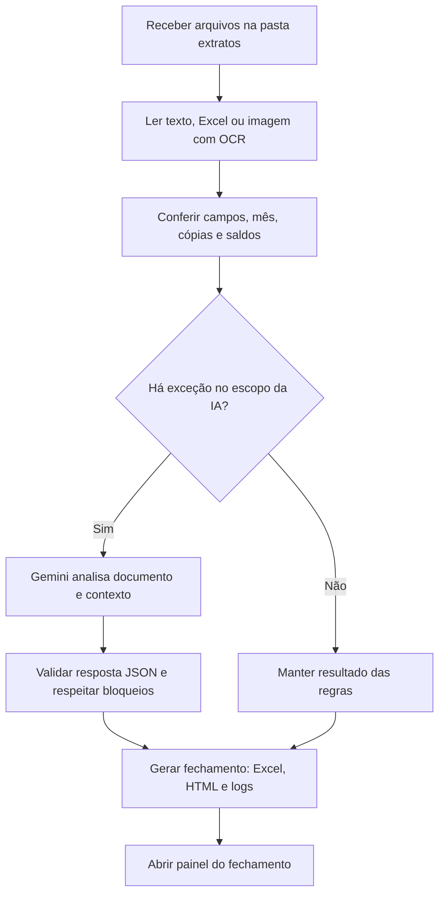
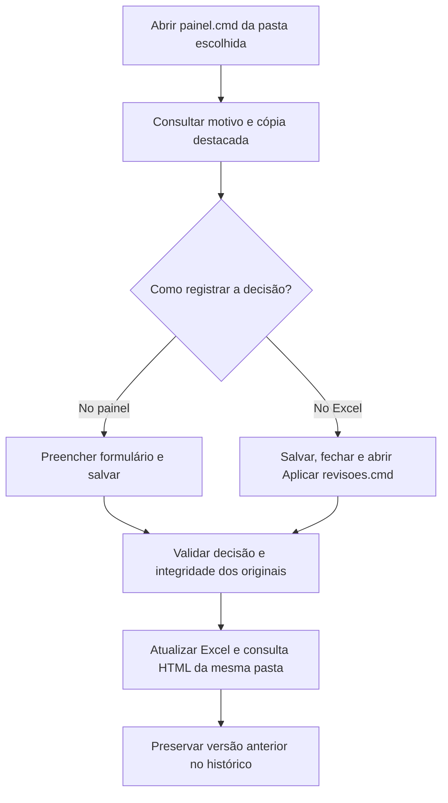
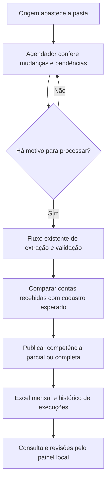

# Goener — consolidação bancária

Versão **1.13.0**. Automação Python de ponta a ponta: lê PDF, imagem e Excel, confere os saldos e publica planilha, relatório e logs. O Gemini ajuda a analisar exceções; regras obrigatórias do Python continuam valendo. No lote fornecido: **17 arquivos, 12 ok, 4 revisar, 1 falhou e R$ 4.114.372,29 no total**. Dados fictícios.

## 1. Usar sem conhecer o código

### Preparar uma vez

Instale Python 3.12, extraia o ZIP completo e, no terminal da pasta, execute:

```powershell
py -3.12 -m pip install -r requirements-lock.txt
```

A chave Gemini fica no `.env` ao lado de `config.toml`. Não vai para o Git. A leitura é automática; não depende de navegador logado. Falha ou ausência de IA não impede a consolidação pelas regras, mas pode deixar pendências. Faturamento e cotas dependem do projeto do provedor; não há promessa de disponibilidade externa.

### Abrir e revisar um fechamento

Dê dois cliques em **Executar automacao.cmd**, na raiz. Ele abre o fechamento mais recente; se não houver resultado, processa os extratos e depois abre o painel. Mantenha a janela do robô aberta.

Cada fechamento tem uma pasta identificada por mês, data e horário dentro de `resultados/`. Não existem mais Excel e HTML soltos nessa raiz.

```text
resultados/
  Fechamento 2026-10 -- 15-11-2026 12h01m00s -- abcd/
    Abrir painel.cmd        abre e edita ESTE fechamento
    Aplicar revisoes.cmd    aplica o Excel salvo DESTE fechamento e abre o painel
    consolidado.xlsx        planilha operacional
    relatorio.html          consulta atualizada após salvar uma revisão
    historico/              versões e evidências técnicas; não edite os snapshots
```

**Para retomar um fechamento específico:** abra **Abrir painel.cmd dentro daquela pasta**. O atalho acompanha a pasta; não contém nome de usuário nem unidade fixa. Não seleciona outra sessão e não extrai tudo novamente. Mantenha a pasta dentro do projeto completo.

**No painel:** Conferir arquivos → expanda um arquivo → Revisar este arquivo → escolha a decisão e preencha os campos → Salvar e atualizar. Isso grava a revisão no Excel e atualiza a consulta HTML **do mesmo fechamento**. As versões anteriores permanecem no histórico. Para atualizar uma consulta já aberta em um snapshot antigo, reabra relatorio.html na pasta do fechamento. O formulário exige Excel fechado ao salvar.

**Se preferir o Excel:** na aba Revisões, preencha as células amarelas, salve e feche. Dê dois cliques em **Aplicar revisoes.cmd na mesma pasta**. Não precisa digitar parâmetros. Não foi criado botão de macro dentro do Excel.

A aba Consolidado tem resumo no topo e as oito colunas do enunciado a partir da linha 7: Arquivo, Banco, Conta, Período, Saldo final, Formato de origem, Status, Observação. Uma linha por arquivo, inclusive cópias e falhas. Revisões mostra pendências e decisões/rascunhos preenchidos; identificadores técnicos ficam ocultos. Nas pendências, a observação inclui **o motivo retornado pela IA**, quando disponível, e não apenas a decisão genérica. Ela é uma recomendação, não comprovação de que o documento está correto.

O link **Abrir relatório com detalhes** na aba Revisões usa URI local explícita para evitar a resolução relativa do Office pelo OneDrive. Ao abrir o painel, o robô atualiza o link para a localização atual do projeto, se o Excel estiver fechado. Após mover/extrair o projeto em outro computador, abra primeiro Abrir painel.cmd para atualizar esse vínculo. A consulta HTML é local; a edição exige o painel em execução. O Office pode pedir confirmação ao abrir o arquivo local; não é um redirecionamento para o OneDrive.

### Decisões e efeitos

| Decisão | Efeito |
| --- | --- |
| Pendente | Mantém as regras; não aplica decisão humana. |
| Liberar | Inclui o saldo original após conferência registrada. |
| Corrigir e liberar | Usa o saldo confirmado, inclusive zero; preserva o original. |
| Excluir | Mantém registro e histórico; saldo fora do total. |

Justificativa, responsável e data são obrigatórios. Cópia idêntica, outro mês ou documento sem dados essenciais não podem ser liberados como válidos: substitua o documento ou refaça o fechamento correto. Uma divergência matemática exige revisão humana explícita para liberação; a IA sozinha não ultrapassa esse bloqueio.

**Saldo exibido não significa saldo aprovado:** os R$ 457.179,12 declarados versus R$ 456.099,12 calculados do exemplo continuam fora da soma. O cartão informa contribuição **R$ 0,00**, aguardando revisão. Nenhum dos dois é escolhido automaticamente.

### Recursos do relatório

| Onde clicar | Para que serve |
| --- | --- |
| Visão geral | Saldo incluído, composição por banco e pendências. |
| Conferir arquivos | Regras, análise da IA, localização e medida aplicada por arquivo. |
| Filtros e busca | Separar ressalvas/IA e buscar arquivo, conta ou banco. |
| Expandir arquivos visíveis | Abrir/recolher os cartões filtrados. |
| Abrir documento de origem | Consultar o original, preservado. |
| Abrir cópia destacada | PDF com grifos numerados e explicações, quando localizáveis com segurança. |
| Revisar este arquivo | Formulário de decisão no painel; desabilitado na consulta HTML aberta diretamente. |
| Salvar e atualizar | Atualiza Excel e HTML da sessão, sem nova chamada de IA. |
| Baixar Excel | Cópia da planilha; edite a operacional na pasta do fechamento. |
| Log da execução | Eventos, avisos e erros daquela publicação. |
| Baixar evidências (JSON) | Extração, validações e resposta da IA em dados estruturados. |
| Verificação de integridade | Manifesto SHA-256; detecta alterações, não autentica o banco emissor. |

As cópias destacadas são PDFs visuais; não alteram o original nem preservam a assinatura/camada textual dele. Sem localização segura, o relatório avisa e não inventa coordenadas. Excel é referenciado por aba/célula; não se promete grifo visual de XLSX.

## 2. Entender o processo

### Fluxo principal



A geração termina mesmo que haja pendências; revisar é uma etapa posterior, sem interromper a automação inicial.

### Fluxo da revisão — separado da extração



Não são refeitos extração financeira e HTTP de IA na revisão. OCR pode ser necessário apenas para localizar grifos. Mudanças nos documentos bloqueiam reaproveitamento e exigem processamento completo.

### Do problema à implementação

O processo manual é receber arquivos de várias contas, abrir cada formato, identificar banco/conta/mês, localizar o saldo final, transcrever, conferir e consolidar. Riscos: duplicidade, competência incorreta, erro de digitação, escolha do saldo inadequado e leitura incompleta.

1. **Mapear o contrato:** entrada em pasta; uma linha por arquivo; oito colunas; problemas em Status/Observação; planilha e log gerados sem etapa manual entre leitura e publicação.
2. **Inspecionar formatos e exceções:** PDF com texto, imagens e Excel; cópia exata, possível lançamento repetido, diferença de conciliação, mês diferente e comunicado sem saldo.
3. **Separar leitura de validação:** os leitores extraem dados/referências; regras gerais conferem os valores sem depender do nome de um arquivo ou de uma diferença específica.
4. **Preservar evidências:** Decimal para centavos, SHA-256, origem dos valores, eventos por documento e histórico de publicações. Uma falha em um arquivo não apaga os demais.
5. **Adicionar IA como complemento:** conferir exceções com o original e JSON validado, sem ferramentas para executar código ou inventar saldos.
6. **Fechar o ciclo operacional:** relatório legível, cópias destacadas e decisões humanas rastreáveis para a mesma versão do documento.
7. **Validar e distribuir:** testes, ensaios reais de OCR/HTTP, conferência visual, CMD e pacote final verificável.

### Como o robô confere as contas

O robô compara os dados com regras explícitas. Créditos são positivos; débitos, negativos:

```text
saldo calculado = saldo inicial + soma das movimentações
saldo após um lançamento = saldo anterior + valor do lançamento
saldo final declarado deve corresponder ao saldo após o último lançamento
```

Exemplo: inicial 1.000 + crédito 200 − débito 50 = esperado 1.150. Se o extrato declara 1.180, a diferença de 30 gera ressalva. O robô preserva 1.180 como informação do original; não troca para 1.150 por conta própria. A comparação usa Decimal e centavos, sem tolerância financeira configurada além da normalização monetária.

### Catálogo das premissas e exceções implementadas

| Grupo | Verificação | Tratamento |
| --- | --- | --- |
| Identificação | Banco, conta, período e saldo final presentes; múltiplas contas no documento. | Campo essencial ausente ou múltiplas contas: falha; não somar. |
| Competência | Período esperado; nome do arquivo não prevalece. Intervalo irregular ou múltiplos meses sem período explícito. | Outro mês: reter; ambiguidades recebem ressalva/falha conforme a leitura. |
| Saldo correto | Final declarado, sem confundir limite ou disponível. Negativo é válido. | Não ajustar para fechar a conta. Em imagem sem cartão final reconhecido, pode registrar o último saldo legível com ressalva. |
| Conciliação geral | Inicial + movimentos deve corresponder ao final declarado. | Diferença: preservar declarado e reter. Inicial ausente impede comprovar a conciliação e gera ressalva. |
| Conciliação por movimento | Anterior + lançamento deve corresponder ao saldo seguinte; último deve coincidir com o declarado. | Registrar posição/diferença e reter. Ausência de movimentos também gera ressalva. |
| Arquivo duplicado | Mesmo SHA-256, mesmo com nomes diferentes. | Original escolhido de forma determinística; cópia registrada, fora dos totais. |
| Conta/período repetidos | Conteúdos diferentes para mesmo banco, conta e período. | Reter: hash diferente não autoriza somar documentos possivelmente sobrepostos. |
| Lançamento repetido | Mesma data, descrição normalizada, valor e referência. | Suspeita: não apagar transação nem descontar do saldo automaticamente. |
| Sinais e datas | Datas interpretáveis; crédito/débito compatíveis; sinal OCR legível. | Tipo/sinal inválido no Excel pode falhar a leitura. Sinal inferido pela variação de saldo em imagem fica ressalvado. |
| Qualidade da leitura | Linha incompleta, movimento sem saldo e baixa confiança OCR em identificação/valores. | Reter/falhar conforme os dados disponíveis; não completar números inventados. |
| Tipo de documento | Comunicado ou ausência de estrutura/campos essenciais de extrato. | Falha/exclusão com motivo; a linha continua registrada. |
| Excel de entrada | Abas ocultas inspecionadas e sinalizadas. Fórmulas não executadas; macros, objetos ativos, conexões externas e XML com entidades recusados. | Rejeitar conteúdo ativo/não suportado. As fórmulas geradas na saída são outro contexto. |
| Integridade e limites | Alteração, caminho externo, link simbólico, formato inválido/corrompido, excesso de bytes/páginas/pixels/células. | Bloquear aquela leitura/análise e registrar causa. |
| IA | JSON, tipos, códigos e leitura coerentes com a extração. | Resposta fora do contrato não aplicada; indisponibilidade não interrompe a publicação do lote. |
| Revisão humana | Decisão permitida, justificativa, responsável, data e saldo quando necessário; nome/hash/fechamento exatos. | Aplicar após validar, mantendo original/histórico. Revisão inválida não libera. |

Status: `falhou` para falha essencial, `revisar` para ressalva e `ok` quando passa. Revisão humana válida pode liberar/corrigir uma divergência; exclusão humana mantém a linha fora da soma. O total usa status `ok`, competência esperada, ausência de cópia e seleção aplicável ao modo de IA/revisão.

### Até onde vão as regras e onde entra a IA

As regras não procuram “Sol do Sertão” nem a diferença de 1.080: conferem valores de qualquer entrada que o leitor consiga interpretar. **Novos layouts exigem validação**; os testes não demonstram cobertura universal de bancos ou problemas.

No escopo padrão de exceções, os 12 regulares do lote dispensam IA; cinco recebem análise. Um problema despercebido pelas regras pode não chegar à IA. `ai_scope = "todos"` acrescenta conferência dos regulares, com mais chamadas e tokens, sem garantia de detectar toda falha.

`off` usa apenas regras locais; `consultivo` registra orientação sem mudar sua seleção; `automatico` aplica retenção/exclusão no escopo analisado. A IA não remove bloqueios obrigatórios nem corrige campos extraídos. **Uma revisão humana explícita é um caminho separado**, com justificativa e integridade verificadas.

O modelo não aprende automaticamente com revisões nem recebe treinamento de pesos. As decisões registradas permitem avaliação supervisionada futura com a gestão. Hoje a reutilização é por cache compatível, não por aprendizado automático.

### Tempo: cálculo por atividade, mês e ano

O HTML continua exclusivamente financeiro e operacional. A estimativa fica no resumo JSON e na documentação de uma página.

O cálculo usa a **população observada por atividade**, não o total bruto de arquivos multiplicado por um tempo único. No lote de referência:

| Atividade | Quantidade observada | Tempo central por unidade | Origem do tempo |
| --- | --- | --- | --- |
| Consolidar extrato único da competência, inclusive os retidos por divergência | 14: 5 PDF, 5 Excel e 4 imagens | 8 min de preenchimento + 2 min de conferência inicial = 10 min | Referência declarada pelo responsável a partir de um arquivo; formato não identificado e medição não auditada. |
| Identificar e encaminhar cópia, outro mês ou documento sem dados suficientes | 3: uma cópia, um extrato de outro mês e um comunicado | 1 min | Hipótese de triagem, não tempo cronometrado. Não inclui resolver a exceção. |

A composição por formato é observada; o tempo de dez minutos ainda é uma referência comum aplicada aos formatos, não uma média estratificada medida. Esses grupos são derivados dos dados de cada execução. Um lote diferente terá outra composição. Os dois extratos com divergências entram no esforço de consolidação; não se confunde “fora do total financeiro” com “sem trabalho manual”. A cópia e o comunicado não recebem dez minutos de transcrição como se fossem novos extratos.

```text
T_manual = N_extratos_unicos_do_mes × t_consolidacao + N_triagem × t_triagem
G_mes = (T_manual_em_segundos − tempo_medido_do_robo) × lotes_mensais / 3.600
G_ano = 12 × G_mes, se volume e composição se repetirem nos 12 meses
```

No cenário central desta composição: `14 × 10 + 3 × 1 = 143 minutos` por lote, antes de descontar o tempo do robô. Com um lote/mês, aproximadamente **2h23/mês e 28h36/ano** na reexecução com cache medida. Não é economia líquida de todo o fechamento: exclui revisão posterior de exceções, espera pelo banco, recebimento e implantação. Não há conversão para dinheiro.

#### Análise de sensibilidade — não intervalo de confiança

| Cenário | Min/extrato a consolidar | Min/triagem | Ganho aproximado mensal | Projeção anual |
| --- | --- | --- | --- | --- |
| Menor ganho | 8 | 0,5 | 1,89 h | 22,70 h |
| Central | 10 | 1 | 2,38 h | 28,60 h |
| Maior ganho | 12 | 2 | 2,90 h | 34,80 h |

Valores arredondados para um lote/mês com a composição acima, descontando a reexecução com cache. Cada execução registra seus próprios valores. O benchmark histórico de primeira execução do pacote, sem IA, levou 38,124 s: aplicando esse tempo, o cenário central seria aproximadamente **2,37 h/mês e 28,47 h/ano**. Ele não representa a latência de uma primeira execução com chamadas reais à IA.

Os limites são hipóteses deliberadas: consolidação a 80%/100%/120% da referência e triagem a 50%/100%/200%. **Não são percentis empíricos, IC de 95% ou limites garantidos.** Não há probabilidade atribuída aos cenários. A projeção anual supõe frequência/volume/composição constantes, sem redução artificial da incerteza por multiplicar por 12.

#### Qualidade da evidência e plano de amostragem

A composição é contada nos arquivos e verificável; a estimativa de tempo é **exploratória**. Há apenas uma referência manual, insuficiente para estimar dispersão ou um IC de 95% defensável. Não se pode afirmar “95% de confiança” sem amostra e variabilidade que sustentem a conta.

Para evoluir: coletar um piloto **estratificado por PDF, Excel e imagem**, com triagem separada; cronometrar arquivos diferentes e tarefas equivalentes; registrar tempo, formato, legibilidade e operador. Calcular média, desvio-padrão e coeficiente de variação por grupo. Dimensionar a amostra pela margem de erro desejada após o piloto; um número arbitrário de observações não garante precisão.

A estimativa mensal passará a usar `soma(N_grupo × media_tempo_grupo) − tempo_robo`. Sob pressupostos adequados de amostragem/independência, um IC para a média de cada grupo pode usar `media ± t × desvio_padrao / raiz(n)`; o resultado agregado exige combinar as variâncias dos grupos, não somar seus ICs. Referência metodológica: [NIST — Confidence Limits for the Mean](https://www.itl.nist.gov/div898/handbook/eda/section3/eda352.htm).

`resumo.json` guarda os grupos, formatos, hipóteses, medição e cenários em `time_estimate` versão 3. `confidence_level` e `empirical_confidence_interval` ficam nulos por falta de evidência. `manual_triage_minutes` e `monthly_batches` são editáveis no config; a referência de preenchimento/conferência também. Nenhum valor depende de o lote ter exatamente 17 arquivos.

### Próximos passos, por prioridade

1. **P1 — Definir um critério mínimo de fechamento com o financeiro.** Cadastro por banco e conta ativa, competência esperada e prazo de entrega. Cada conta esperada precisa ter um extrato válido do mês, com saldo e identificação, sem bloqueio crítico. Cópias não contam duas vezes; recebido não significa validado. Contas ausentes mantêm o fechamento parcial. No prazo, publicar entrega com ressalvas sem chamá-la de completa. A quantidade de arquivos, sozinha, não comprova completude.
2. **P2 — Agendar conferência da pasta e consolidar por mês.** Verificar a cada hora ou diariamente e comparar inclusões, alterações e remoções por hash. Mudança de código/configuração/competência, prazo atingido ou IA pendente com nova janela também podem exigir processamento. Reconstruir `resultados/AAAA-MM/consolidado.xlsx`, sem acrescentar linhas duplicadas; publicar somente após validação e preservar histórico. Revisões manuais ficam em cópia separada. Esta evolução ainda não está implementada.
3. **P3 — Homologar a operação e as decisões.** Validar novos layouts, retomadas, revisões e critérios de aprovação com o financeiro; acompanhar erros da extração e decisões da IA antes de ampliar o uso automático.



Este desenho é futuro. O processo só inclui recebimento sem trabalho manual se a origem abastecer a pasta automaticamente. Ausência de mudanças não significa que todos os documentos chegaram. O robô não autentica extratos nem substitui conciliação com o razão contábil.


## 3. Referência técnica

### Componentes

| Parte | Responsabilidade |
| --- | --- |
| executar.py / CMD | Inicialização, diagnósticos e erros visíveis. |
| sessao.py | Seleção do fechamento e atalhos portáteis por pasta. |
| pipeline.py | Orquestração, publicação, trava e retomada. |
| readers.py | pdfplumber, openpyxl, RapidOCR/ONNX em CPU. |
| core.py | Decimal, regras financeiras e estrutura dos dados. |
| ai.py | HTTPS, contexto/documento, contrato JSON, retries e failover. |
| reporting.py / revisoes.py | Planilha, HTML, decisões e destaques. |
| painel.py | Servidor local 127.0.0.1; não é hospedagem pública. |
| entrega.py | ZIP privado e documento de uma página. |

### Comandos para uso técnico

```powershell
# Novo processamento completo: cria outro fechamento
py -3.12 executar.py
# Abrir o fechamento mais recente, sem reprocessar
py -3.12 executar.py --panel
# Abrir um fechamento específico
py -3.12 executar.py --session "resultados/PASTA DO FECHAMENTO" --panel
# Aplicar o Excel salvo de um fechamento
py -3.12 executar.py --session "resultados/PASTA DO FECHAMENTO" --update-reviews --panel
```

Também disponíveis: --ai-mode off/consultivo/automatico, --ai-scope excecoes/todos, --period AAAA-MM, --no-cache, --no-ocr e --strict. O CMD aceita parâmetros explícitos, mas os atalhos das pastas dispensam isso para o usuário comum. O fechamento mantém competência e modo originais ao ser reaberto pelo seu atalho.

config.toml usa caminhos relativos ao projeto. O índice do fechamento mais recente fica em .local/runtime/sessao_atual.json, separado dos resultados. Cache, logs de abertura e trava também ficam em .local/runtime. Cada fechamento tem sua própria base operacional; o painel não segue o índice global após abrir.

### Contrato de resposta da IA

Exemplo ilustrativo do JSON no modo completo:

```json
{
  "decision":"revisar",
  "reason":"O saldo declarado diverge das movimentações.",
  "evidence_codes":["CONCILIACAO_NAO_FECHA"],
  "source_check":{
    "bank":"Banco Aurora","account":"31827-4","period":"2026-10",
    "closing":"457179.12","readable":true,
    "location":"página 1","quote":"31/10/2026 SALDO FINAL 457.179,12 C"
  }
}
```

As decisões da IA são `considerar`, `nao_considerar` e `revisar`, distintas das quatro decisões humanas. O Python valida estrutura, tipos, códigos conhecidos e coerência com a extração. O motivo é texto explicativo; não vira comando. JSON válido não comprova interpretação correta.

### Hash e cache

SHA-256 é uma impressão digital dos bytes do arquivo, calculada localmente com `hashlib`. Reconhece cópias exatas; documentos com os mesmos dados mas outra estrutura podem ter hashes diferentes. Banco, conta e competência repetidos em conteúdos diferentes recebem uma ressalva própria. A leitura também verifica se o original mudou durante o processamento ou antes do envio à IA; uma alteração nessa janela bloqueia aquela análise.

O SQLite, acessado pela biblioteca padrão `sqlite3`, guarda dados em `.local/runtime/`. `extractions.sqlite3` reaproveita extrações por hash, formato, código e opções de leitura, reaplicando as regras em cada execução. `gemini.sqlite3` guarda respostas válidas, tentativas e bloqueios de cota. A resposta de IA é reutilizada por até 30 dias se modelo, instruções e requisição forem iguais. Mudar low/high invalida essa chave. Não se armazena a chave da API nesses bancos. `--no-cache` força nova análise, respeitando cotas.

### Como a leitura identifica os lançamentos sem Gemini

A extração combina **expressões regulares, palavras-chave e posição dos campos**, com leitores para os layouts mapeados. A conta financeira posterior é determinística. “Sem IA” nos ensaios significa sem IA generativa externa; o OCR usa um modelo local de reconhecimento de texto.

- **PDF com texto:** pdfplumber extrai palavras e coordenadas; o programa agrupa palavras próximas em linhas. Procura rótulos como SALDO ANTERIOR, SALDO FINAL e SALDO EM. Regex identifica datas no início das linhas e valores monetários brasileiros, inclusive C/D. Uma linha de movimento deve fornecer valor e saldo; se não tiver os dois, recebe ressalva. Havendo colunas Crédito/Débito, a posição horizontal ajuda a atribuir o sinal. Descrição e referência são separadas por padrões.
- **PDF digitalizado:** quando a página não devolve palavras, é renderizada a 150 DPI e lida pelo RapidOCR. O texto e as posições resultantes entram no leitor de linhas de PDF. OCR não significa interpretação financeira universal; PDF com texto parcial/confuso não aciona automaticamente essa mesma recuperação em todos os casos.
- **Imagem de aplicativo:** um leitor próprio reconhece o layout de cartões mapeado. Usa rótulos como SALDO FINAL, valores com R$, posição à direita, saldo logo abaixo e descrição/data à esquerda. Proximidade e limites espaciais associam movimento ao saldo. Sinal ilegível só é inferido quando a variação de saldo sustenta o valor, sempre com ressalva; caso contrário, é sinalizado como ausente.

Depois, todos os leitores produzem uma estrutura comum: data, descrição, valor com sinal, saldo e localização. Exemplo: saldo anterior 1.000, crédito 200 e débito 50 produzem 1.150. O programa compara tanto os saldos intermediários quanto `saldo inicial + soma dos movimentos` e o final declarado, usando Decimal.

**Limitação de layout:** a regra matemática é geral, mas o reconhecimento dos campos depende dos padrões de leitura implementados. Outra ordem de colunas, descrição quebrada em várias linhas, rótulo diferente, cartões reorganizados ou OCR incorreto podem exigir adaptação do leitor. As coordenadas são referências locais do layout, não compreensão semântica de qualquer documento. Conciliação correta também não prova, sozinha, que toda a extração esteja correta. O Gemini pode ajudar a apontar diferenças, mas não reescreve o leitor nem substitui silenciosamente os dados extraídos.

**Autoridade das decisões:** a precedência vem da política implementada, não de Python ser infalível. Uma divergência obrigatória mantém o saldo retido mesmo se a IA recomendar considerar. Liberação/correção exige revisão humana registrada, e erro no próprio leitor deve ser investigado e corrigido no código.

### OCR e envio multimodal

RapidOCR usa **PP-OCRv4 Mobile com ONNX Runtime em CPU**, retornando texto, confiança e posição dos trechos. Baixa confiança gera ressalva. PDF com texto utilizável é lido pelo pdfplumber; páginas digitalizadas usam OCR. Excel é lido pelo openpyxl. Não usamos Tesseract nem afirmamos superioridade sem benchmark.

No padrão `ai_document_mode = "completo"`, o Gemini recebe **o PDF ou a imagem original**, codificados em Base64 no campo `inlineData` de um POST HTTPS. `mimeType` identifica o formato. Base64 é transporte, não OCR, criptografia ou compactação. O modelo multimodal reconstrói e analisa texto e elementos visuais. Junto seguem extração local, premissas, movimentos e problemas identificados. O modo `dados` envia somente a extração disponível.

Para Excel, enviamos as células preenchidas de todas as abas como texto estruturado, preservando aba, endereço e conteúdo. Por exemplo, uma aba Extrato com Banco em A1, Banco Aurora em B1, Saldo final em A2 e 1.234,56 em B2 chega assim:

```json
{"source_workbook":[{"sheet":"Extrato","visibility":"visible","cells":[
  {"cell":"A1","value":"Banco"},{"cell":"B1","value":"Banco Aurora"},
  {"cell":"A2","value":"Saldo final"},{"cell":"B2","value":"1234.56"}
]}]}
```

Os conteúdos são serializados como strings. Fórmulas seguem literalmente como texto, sem execução. Gráficos, imagens incorporadas e formatação do Excel não são enviados. O mapa permite citar “aba Extrato, célula B2”.

Limites: até 8 MB por original enviado, limite de páginas/pixels configurado, até 30 mil células e 100 mil caracteres por contexto/texto de planilha. Exceder limites registra indisponibilidade; não há corte silencioso. Caminhos fora da entrada, links simbólicos e alteração de hash são bloqueados.

### IA: decisão, raciocínio e disponibilidade

Padrão: **automático somente nas exceções**, uma chamada por documento (`ai_batch_size = 1`). Os 12 arquivos regulares dispensam IA. Consultivo registra orientação sem mudar a seleção pelas regras. Automático aplica retenções e exclusões, mas não supera bloqueios financeiros obrigatórios nem altera banco, conta, período ou saldo extraídos.

O contrato JSON exige `decision`, `reason` e `evidence_codes`; no modo completo, também `source_check` com banco, conta, período, saldo, legibilidade, localização e citação. O Python valida campos, tipos, códigos e coerência com a leitura local. JSON válido não comprova interpretação correta. As instruções ficam versionadas em `goener/ai.py`, sem agente persistente ou treinamento de pesos. Arquivos, fórmulas e OCR são dados não confiáveis; suas instruções não são executadas. O modelo não recebe ferramentas.

**3.8 → 3.5 Flash-Lite → 3.1 Flash-Lite**, com a mesma chave/projeto. Cada modelo pode fazer até três tentativas para 500/502/503/504, timeout ou rede, com espera crescente. HTTP 429 alterna diretamente, registrando cota e espera quando informadas. 400/401/403, contrato inválido e bloqueio de segurança não são contornados por outro modelo. Uma decisão válida encerra a busca, inclusive negativa. Se todos falharem, o lote termina com a ressalva. Resultados individuais concluídos não são reenviados nessa execução.

O programa respeita orçamento de tempo, pausa de modelos e cotas persistentes. O limite local dos Lite é 12 RPM/450 RPD, abaixo dos 15 RPM/500 RPD observados no projeto; para o 3.8, aplica o teto observado de 5 RPM/20 RPD. Os valores atuais do provedor prevalecem; consumo em outros programas não é visto pelo contador local. A pausa diária local é calculada pela meia-noite do Pacífico; as condições efetivas do provedor prevalecem. Não existe garantia de disponibilidade externa.

Os três modelos recebem **thinking HIGH**. PDFs/imagens usam também **resolução de mídia HIGH**: são controles independentes, como esforço de análise e detalhe de uma lupa. O OCR local não possui esse low/high. O teto definido pelo robô é 8.192 tokens de geração por chamada, incluindo raciocínio e resposta, sem contar a entrada. Ele não obriga o modelo a gastar o teto.

Nos cinco documentos do ensaio, o total passou de **23.382 tokens em low para 27.911 em high**, com entradas iguais: 22.512 tokens em ambas as rodadas. Em high, foram 4.518 tokens de raciocínio e 881 de resposta. Foram cinco chamadas e cinco respostas válidas; esse ensaio não garante uma proporção fixa nem prova maior precisão. Registros em `validacao/comparacao_tokens.json` e nas execuções preservadas. Em projeto pago, raciocínio pode aumentar o custo; no Free Tier continuam valendo cotas e disponibilidade. Metadados de uso ficam em `ai.usage`, sem copiar raciocínio interno para os relatórios.

`ai_batch_size = 5` permanece como opção de agrupamento. Nesse modo, IDs associam cada resultado ao documento; uma falha exige reenviar o grupo completo. O padrão individual foi escolhido para reduzir retrabalho e facilitar retomadas.


## 4. Validação e entrega

Testes e registros ficam em validacao/. A suíte cobre regras financeiras, duplicidade, OCR, JSON, retries, fórmulas, segurança de entrada, publicação, revisão, arquivos alterados e isolamento entre dois fechamentos. A abertura no Excel Desktop e a navegação do link são verificadas separadamente; abrir com openpyxl não basta para comprovar compatibilidade.

```powershell
py -3.12 -m ruff check goener executar.py validacao
py -3.12 -m pytest -q
py -3.12 -m goener.entrega --include-env
```

A entrega tem três arquivos: goener_automacao.zip, consolidado.xlsx e documentacao_1_pagina.pdf. O ZIP contém o projeto e um resultado de referência em resultado/, com Abrir painel.cmd e Aplicar revisoes.cmd próprios. Novos fechamentos são criados em resultados/. O empacotamento compara fontes atuais e preserva os artefatos da execução escolhida. Não há EXE/PyInstaller nem macros.

Fonte, configuração e validação são versionados. Relatórios, ZIP, cache e .env não vão para o Git. O ZIP privado inclui .env somente por solicitação explícita do responsável; quem receber a chave poderá consumir a cota dela. Não publique esse pacote privado em repositório aberto.

O servidor aceita somente origem local e token da sessão, rejeita tela antiga e não serve .env. Responsável é informado pelo operador, não autenticação corporativa. Não exponha o painel na rede. Hash detecta diferença de conteúdo, não garante autenticidade ou qualidade da leitura. Os testes nesta máquina não substituem homologação de novos formatos ou de outro Excel.
