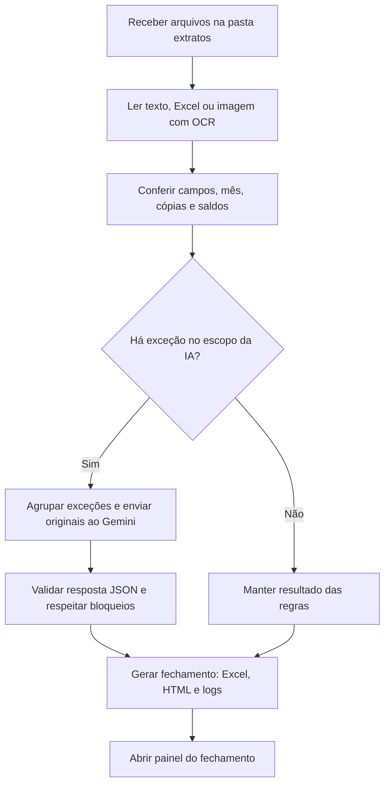
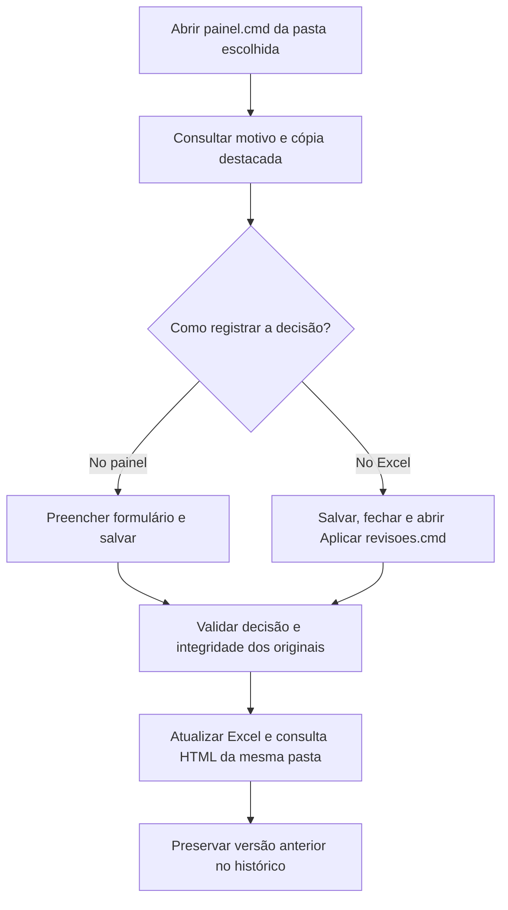
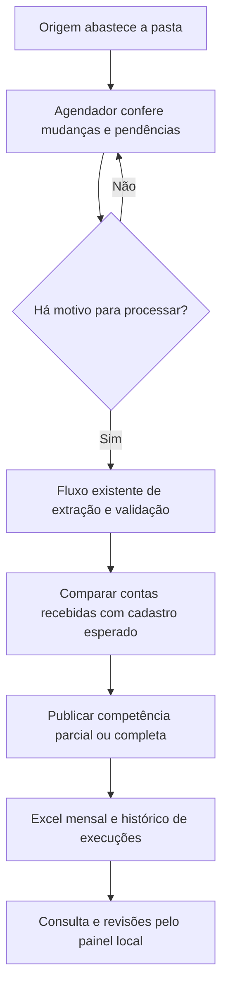

# Goener — consolidação bancária

Versão **1.14.0**. Automação Python de ponta a ponta: lê PDF, imagem e Excel, confere os saldos e publica planilha, relatório e logs. O Gemini ajuda a analisar exceções; regras obrigatórias do Python continuam valendo. No lote fornecido: **17 arquivos, 12 ok, 4 revisar, 1 falhou e R$ 4.114.372,29 no total**. Dados fictícios.

## 1. Usar sem conhecer o código

### Preparar uma vez

Instale Python 3.12, extraia o ZIP completo e, no terminal da pasta, execute:

```powershell
py -3.12 -m pip install -r requirements-lock.txt
```

**Coloque os arquivos que serão processados na pasta `extratos/`, dentro do projeto, antes de iniciar o robô.** O caminho pode ser alterado em `config.toml`.

A chave Gemini fica no `.env` ao lado de `config.toml`. Não vai para o Git. A leitura é automática; não depende de navegador logado. Falha ou ausência de IA não impede a consolidação pelas regras, mas pode deixar pendências. Faturamento e cotas dependem do projeto do provedor; não há promessa de disponibilidade externa.

### Abrir e revisar um fechamento

Dê dois cliques em **Executar automacao.cmd**, na raiz. Ele inicia um novo processamento dos extratos e depois abre o painel do novo fechamento. Para retomar uma execução existente, use Abrir painel.cmd dentro da pasta daquele fechamento. Mantenha a janela do robô aberta.

Cada fechamento tem uma pasta identificada por mês, data e horário dentro de `resultados/`. Não existem mais Excel e HTML soltos nessa raiz.

```text
resultados/
  controle/                 cache, cotas, trava e índice compartilhados
  Fechamento 2026-10 -- 15-11-2026 12h01m00s -- abcd/
    Abrir painel.cmd        abre e edita ESTE fechamento
    Aplicar revisoes.cmd    aplica o Excel salvo DESTE fechamento e abre o painel
    consolidado.xlsx        planilha operacional
    relatorio.html          consulta atualizada após salvar uma revisão
    runtime/                área técnica deste fechamento
      diagnosticos/         diagnóstico de inicialização
      historico/
        <versão>/           Excel/HTML daquela publicação, evidências e manifesto
          logs/             logs daquela versão
          destaques/        cópias dos documentos com grifos
```

**Para retomar um fechamento específico:** abra **Abrir painel.cmd dentro daquela pasta**. O atalho acompanha a pasta; não contém nome de usuário nem unidade fixa. Não seleciona outra sessão e não extrai tudo novamente. Mantenha a pasta dentro do projeto completo.

**No painel:** Conferir arquivos → expanda um arquivo → Revisar este arquivo → escolha a decisão e preencha os campos → Salvar e atualizar. Isso grava a revisão no Excel e atualiza a consulta HTML **do mesmo fechamento**. As versões anteriores permanecem no histórico. Para atualizar uma consulta já aberta em um snapshot antigo, reabra relatorio.html na pasta do fechamento. O formulário exige Excel fechado ao salvar.

**Se preferir o Excel:** na aba Revisões, preencha as células amarelas, salve e feche. Dê dois cliques em **Aplicar revisoes.cmd na mesma pasta**. Não precisa digitar parâmetros. Não foi criado botão de macro dentro do Excel.

A aba Consolidado tem os indicadores de quantidade alinhados verticalmente nas colunas A/B (incluídos, para conferir, com falha e recebidos), resumo no topo e as oito colunas do enunciado a partir da linha 7: Arquivo, Banco, Conta, Período, Saldo final, Formato de origem, Status, Observação. Uma linha por arquivo, inclusive cópias e falhas. Revisões mostra apenas casos que exigem decisão e decisões/rascunhos preenchidos; identificadores técnicos ficam ocultos. Nas pendências, a observação inclui **o motivo retornado pela IA**, quando disponível, e não apenas a decisão genérica. Ela é uma recomendação, não comprovação de que o documento está correto.

O link **Abrir relatório com detalhes** na aba Revisões usa URI local explícita para evitar a resolução relativa do Office pelo OneDrive. Ao abrir o painel, o robô atualiza o link para a localização atual do projeto, se o Excel estiver fechado. Após mover/extrair o projeto em outro computador, abra primeiro Abrir painel.cmd para atualizar esse vínculo. A consulta HTML é local; a edição exige o painel em execução. O Office pode pedir confirmação ao abrir o arquivo local; não é um redirecionamento para o OneDrive.

### Decisões e efeitos

Na aba Revisões, clique na célula da coluna **Decisão** e use a seta da lista (ou Alt+↓). Não digite zero para excluir: escolha **Excluir** e deixe Saldo confirmado vazio. Para aceitar os R$ 457.179,12 declarados, escolha **Liberar saldo original**, sem preencher outro valor. Para substituir por R$ 456.099,12 após conferência, escolha **Corrigir e liberar** e informe 456099,12. Zero só deve ser informado se o saldo correto for realmente R$ 0,00. A coluna de valor fica cinza quando a decisão não exige preenchimento. Justifique, informe responsável/data, salve e feche o Excel e abra Aplicar revisoes.cmd do mesmo fechamento.

Cópias exatas são exclusões determinísticas. No modo automático, documento de outra competência pode ser encerrado como exclusão quando a leitura legível da IA confirma o mesmo período identificado pelas regras, com localização/citação e sem divergência de leitura. Documento sem saldo/movimentos pode ser encerrado quando a IA recomenda não considerar e cita explicitamente que não é extrato. Esses casos permanecem no Consolidado e na consulta Todos/Tratados do HTML, fora dos totais, e saem da fila de decisão. Se houver incerteza ou discordância, continuam pendentes. Divergência matemática não é liberada pela IA; exige revisão registrada.

Os três Status do enunciado (ok/revisar/falhou) são mantidos para compatibilidade. O indicador **Com ressalvas** conta o status revisar; não equivale ao número de decisões humanas pendentes. A aba Revisões e o filtro Revisão necessária mostram a fila operacional. No lote de referência, são três exclusões concluídas (cópia, comunicado e outro mês) e dois casos para decisão (lançamento suspeito e divergência de saldo).

| Decisão | Efeito |
| --- | --- |
| Pendente | Mantém as regras; não aplica decisão humana. |
| Liberar saldo original | Inclui o saldo original após conferência registrada. |
| Corrigir e liberar | Usa o saldo confirmado, inclusive zero; preserva o original. |
| Excluir | Mantém registro e histórico; saldo fora do total. |

Justificativa, responsável e data são obrigatórios. Cópia idêntica, outro mês ou documento sem dados essenciais não podem ser liberados como válidos: substitua o documento ou refaça o fechamento correto. Uma divergência matemática exige revisão humana explícita para liberação; a IA sozinha não ultrapassa esse bloqueio.

**Saldo exibido não significa saldo aprovado:** os R$ 457.179,12 declarados versus R$ 456.099,12 calculados do exemplo continuam fora da soma. O cartão informa contribuição **R$ 0,00**, aguardando revisão. Nenhum dos dois é escolhido automaticamente.

### Recursos do relatório

| Onde clicar | Para que serve |
| --- | --- |
| Visão geral | Saldo incluído, composição por banco e pendências. |
| Conferir arquivos | Regras, análise da IA, localização e medida aplicada por arquivo. |
| Filtros e busca | Separar ressalvas/IA e buscar arquivo, conta ou banco. |
| Expandir arquivos visíveis | Abrir/recolher os cartões filtrados. |
| Abrir documento de origem | Consultar o original, preservado. |
| Abrir cópia destacada | PDF com grifos numerados e explicações, quando localizáveis com segurança. |
| Revisar este arquivo | Formulário de decisão no painel; desabilitado na consulta HTML aberta diretamente. |
| Salvar e atualizar | Atualiza Excel e HTML da sessão, sem nova chamada de IA. |
| Baixar Excel | Cópia da planilha; edite a operacional na pasta do fechamento. |
| Log da execução | Eventos, avisos e erros daquela publicação. |
| Baixar evidências (JSON) | Extração, validações e resposta da IA em dados estruturados. |
| Verificação de integridade | Manifesto SHA-256; detecta alterações, não autentica o banco emissor. |

As cópias destacadas são PDFs visuais; não alteram o original nem preservam a assinatura/camada textual dele. Sem localização segura, o relatório avisa e não inventa coordenadas. Excel é referenciado por aba/célula; não se promete grifo visual de XLSX.

## 2. Entender o processo

### Fluxo principal



A geração termina mesmo que haja pendências; revisar é uma etapa posterior, sem interromper a automação inicial.

### Fluxo da revisão — separado da extração



Não são refeitos extração financeira e HTTP de IA na revisão. OCR pode ser necessário apenas para localizar grifos. Mudanças nos documentos bloqueiam reaproveitamento e exigem processamento completo.

### O que a IA analisa e o que ela pode alterar

A leitura do original pela IA já existia. Entretanto, o prompt anterior condicionava o parecer às pendências do Python. **No prompt versão 3**, o alerta é tratado explicitamente como hipótese: a IA pode concordar, discordar por erro de leitura/premissa inadequada e apontar outro problema no campo de justificativa, citando localização e evidência. Não há treinamento com os arquivos nem agente persistente; são instruções versionadas e contexto enviado por HTTPS.

**Exemplo observado nos testes reais:** o Gemini recomendou considerar o extrato Lagoa Azul porque os dois PIX semelhantes constavam no original e a conciliação fechava. O Python manteve o status revisar conforme a política vigente. Isso demonstra uma discordância registrada, não comprova que os dois recebimentos sejam economicamente legítimos.

**Parecer e aplicação são coisas separadas.** O campo decision e o motivo da IA são registrados sem convertê-los artificialmente para concordar com o robô. No modo consultivo, são recomendações. No automático, retenções/exclusões podem ser aplicadas, mas uma regra obrigatória pendente ainda impede liberar o saldo: isso aparece como policy_block. A IA pode discordar do alerta sem ganhar autorização para substituir valores ou liberar um bloqueio sozinha. Uma revisão humana registrada pode autorizar a correção/liberação nos casos permitidos.

As análises já salvas mantêm a versão de prompt usada originalmente. Reabrir o painel ou aplicar Revisões não reenviam documentos; um novo processamento usa o prompt atual. Respostas em cache de outra versão do prompt não são usadas em novas chamadas.

### Documentos diferentes e falhas não previstas

| Situação | O que acontece hoje |
| --- | --- |
| Documento legível de formato aceito, mas campos/movimentos não reconhecidos | As regras registram falhou/revisar. No escopo excecoes, vai para a IA; no modo completo, segue o PDF/imagem ou as células de todas as abas, respeitados os limites. |
| Regra encontra uma divergência diferente das do exemplo | O contexto e os achados seguem para a IA. A conta financeira não depende do nome do arquivo nem da diferença ser R$ 1.080. A justificativa da IA pode descrever problemas sem código prévio. |
| Campos parecem válidos e todas as regras passam | No padrão excecoes, não chama a IA. Isso não prova ausência de todo erro possível, inclusive um problema não previsto que ainda passe pelas verificações implementadas. O escopo todos permite uma segunda leitura de cada arquivo, com mais consumo e tempo. |
| Arquivo corrompido, tipo não suportado, limite excedido ou risco de conteúdo ativo | Registra a falha e não tenta contornar as restrições. O original só é enviado se passar pela preparação segura; nem toda falha de arquivo pode ser enviada à IA. |
| Queda de API, rede, cota ou resposta inválida | Retries/failover conforme a categoria; se não houver resposta válida, registra IA indisponível e publica o resultado das regras com as pendências. |
| Arquivo mudou durante leitura ou revisão | Hash impede aplicar análise/revisão sobre outra versão; exige processamento adequado da nova entrada. |

**Proteção operacional não é cobertura semântica universal.** Há validação de estrutura, tamanho, páginas, pixels, campos essenciais, sinais, conciliação e integridade, além de tratamento de falha por arquivo, trava e logs. O reconhecimento local usa padrões de campos/posição; não interpreta automaticamente qualquer organização. Uma extração incompleta que ainda produza números plausíveis pode escapar das regras e, no escopo excecoes, não chegar à IA. Essa limitação permanece mesmo com proteções de infraestrutura. Novos problemas não precisam coincidir com os exemplos para serem sinalizados, mas não há garantia de detectar todos eles.

Um teste usa PDF legível com estrutura diferente, confirma a retenção e verifica que o original chega à camada de IA. A resposta nesse teste é controlada: valida o encaminhamento e o contrato, não demonstra que o Gemini compreenderá qualquer documento real. Outro teste preserva um parecer da IA discordante, sem confundi-lo com liberação financeira.

### Do problema à implementação

O processo manual é receber arquivos de várias contas, abrir cada formato, identificar banco/conta/mês, localizar o saldo final, transcrever, conferir e consolidar. Riscos: duplicidade, competência incorreta, erro de digitação, escolha do saldo inadequado e leitura incompleta.

1. **Mapear o contrato:** entrada em pasta; uma linha por arquivo; oito colunas; problemas em Status/Observação; planilha e log gerados sem etapa manual entre leitura e publicação.
2. **Inspecionar formatos e exceções:** PDF com texto, imagens e Excel; cópia exata, possível lançamento repetido, diferença de conciliação, mês diferente e comunicado sem saldo.
3. **Separar leitura de validação:** os leitores extraem dados/referências; regras gerais conferem os valores sem depender do nome de um arquivo ou de uma diferença específica.
4. **Preservar evidências:** Decimal para centavos, SHA-256, origem dos valores, eventos por documento e histórico de publicações. Uma falha em um arquivo não apaga os demais.
5. **Adicionar IA como complemento:** conferir exceções com o original e JSON validado, sem ferramentas para executar código ou inventar saldos.
6. **Fechar o ciclo operacional:** relatório legível, cópias destacadas e decisões humanas rastreáveis para a mesma versão do documento.
7. **Validar e distribuir:** testes, ensaios reais de OCR/HTTP, conferência visual, CMD e pacote final verificável.

### Como o robô confere as contas

O robô compara os dados com regras explícitas. Créditos são positivos; débitos, negativos:

```text
saldo calculado = saldo inicial + soma das movimentações
saldo após um lançamento = saldo anterior + valor do lançamento
saldo final declarado deve corresponder ao saldo após o último lançamento
```

Exemplo: inicial 1.000 + crédito 200 − débito 50 = esperado 1.150. Se o extrato declara 1.180, a diferença de 30 gera ressalva. O robô preserva 1.180 como informação do original; não troca para 1.150 por conta própria. A comparação usa Decimal e centavos, sem tolerância financeira configurada além da normalização monetária.

### Catálogo das premissas e exceções implementadas

| Grupo | Verificação | Tratamento |
| --- | --- | --- |
| Identificação | Banco, conta, período e saldo final presentes; múltiplas contas no documento. | Campo essencial ausente ou múltiplas contas: falha; não somar. |
| Competência | Período esperado; nome do arquivo não prevalece. Intervalo irregular ou múltiplos meses sem período explícito. | Outro mês: reter; ambiguidades recebem ressalva/falha conforme a leitura. |
| Saldo correto | Final declarado, sem confundir limite ou disponível. Negativo é válido. | Não ajustar para fechar a conta. Em imagem sem cartão final reconhecido, pode registrar o último saldo legível com ressalva. |
| Conciliação geral | Inicial + movimentos deve corresponder ao final declarado. | Diferença: preservar declarado e reter. Inicial ausente impede comprovar a conciliação e gera ressalva. |
| Conciliação por movimento | Anterior + lançamento deve corresponder ao saldo seguinte; último deve coincidir com o declarado. | Registrar posição/diferença e reter. Ausência de movimentos também gera ressalva. |
| Arquivo duplicado | Mesmo SHA-256, mesmo com nomes diferentes. | Original escolhido de forma determinística; cópia registrada, fora dos totais. |
| Conta/período repetidos | Conteúdos diferentes para mesmo banco, conta e período. | Reter: hash diferente não autoriza somar documentos possivelmente sobrepostos. |
| Lançamento repetido | Mesma data, descrição normalizada, valor e referência. | Suspeita: não apagar transação nem descontar do saldo automaticamente. |
| Sinais e datas | Datas interpretáveis; crédito/débito compatíveis; sinal OCR legível. | Tipo/sinal inválido no Excel pode falhar a leitura. Sinal inferido pela variação de saldo em imagem fica ressalvado. |
| Qualidade da leitura | Linha incompleta, movimento sem saldo e baixa confiança OCR em identificação/valores. | Reter/falhar conforme os dados disponíveis; não completar números inventados. |
| Tipo de documento | Comunicado ou ausência de estrutura/campos essenciais de extrato. | Falha/exclusão com motivo; a linha continua registrada. |
| Excel de entrada | Abas ocultas inspecionadas e sinalizadas. Fórmulas não executadas; macros, objetos ativos, conexões externas e XML com entidades recusados. | Rejeitar conteúdo ativo/não suportado. As fórmulas geradas na saída são outro contexto. |
| Integridade e limites | Alteração, caminho externo, link simbólico, formato inválido/corrompido, excesso de bytes/páginas/pixels/células. | Bloquear aquela leitura/análise e registrar causa. |
| IA | JSON, tipos, códigos e leitura coerentes com a extração. | Resposta fora do contrato não aplicada; indisponibilidade não interrompe a publicação do lote. |
| Revisão humana | Decisão permitida, justificativa, responsável, data e saldo quando necessário; nome/hash/fechamento exatos. | Aplicar após validar, mantendo original/histórico. Revisão inválida não libera. |

Status: `falhou` para falha essencial, `revisar` para ressalva e `ok` quando passa. Revisão humana válida pode liberar/corrigir uma divergência; exclusão humana mantém a linha fora da soma. O total usa status `ok`, competência esperada, ausência de cópia e seleção aplicável ao modo de IA/revisão.

### Até onde vão as regras e onde entra a IA

As regras não procuram “Sol do Sertão” nem a diferença de 1.080: conferem valores de qualquer entrada que o leitor consiga interpretar. **Novos layouts exigem validação**; os testes não demonstram cobertura universal de bancos ou problemas.

No escopo padrão de exceções, os 12 regulares do lote dispensam IA; cinco recebem análise. Um problema despercebido pelas regras pode não chegar à IA. `ai_scope = "todos"` acrescenta conferência dos regulares, com mais dados e tokens, podendo exigir divisão do lote, sem garantia de detectar toda falha.

`off` usa apenas regras locais; `consultivo` registra orientação sem mudar sua seleção; `automatico` aplica retenção/exclusão no escopo analisado. A IA não remove bloqueios obrigatórios nem corrige campos extraídos. **Uma revisão humana explícita é um caminho separado**, com justificativa e integridade verificadas.

O modelo não aprende automaticamente com revisões nem recebe treinamento de pesos. As decisões registradas permitem avaliação supervisionada futura com a gestão. Hoje a reutilização é por cache compatível, não por aprendizado automático.

### Tempo: medição completa e estimativa de economia

**0,94 s era o tempo de atualizar uma revisão com dados reaproveitados. Não representava a execução completa.** Abrir o painel também não equivale a processar os documentos.

A referência de desempenho agora é um ensaio de **três execuções completas**, com 17 arquivos, leitura/OCR sem cache, análise das exceções via HTTP com raciocínio high, agrupamento e sem cache local de respostas, geração de destaques, Excel, HTML, manifesto e publicação. Um processo externo mede da inicialização do Python até seu encerramento, incluindo importações. Instalação, navegador aguardando o operador e revisão humana não entram no cronômetro.

| Rodada | Tempo completo | Análises válidas de IA | Tentativas HTTP |
| --- | --- | --- | --- |
| 1 | 119,51 s | 5/5 | 4 |
| 2 | 43,89 s | 5/5 | 1 |
| 3 | 49,51 s | 5/5 | 2 |

**Média geral do ensaio: 70,97 s (1 min 10,97 s).** Mínimo 43,89 s; máximo 119,51 s; desvio-padrão amostral 42,13 s. Foram **15/15 análises válidas**, em um grupo de cinco por rodada, e sete tentativas HTTP no total. Todas publicaram os 17 registros. A primeira teve timeouts e 503 antes da recuperação; a terceira teve 503 e retry bem-sucedido. Um grupo lógico pode gerar várias tentativas por disponibilidade.

**Referência adotada para a projeção: 46,70 s**, média das rodadas 2 e 3 (43,89 s e 49,51 s), nas quais o 3.8 foi pulado por cota diária esgotada, sem tentativas HTTP nesse modelo. Inclui leitura/OCR, análise agrupada high, geração e publicação, além do 503/retry no 3.5 da terceira rodada. São duas medições do cenário sem tentativas no 3.8, não uma garantia de duração. A rodada 1 permanece na tabela e na média geral para auditoria; não entra nesta referência de cenário. Se o 3.8 voltar a ser tentado, esta referência pode não representar o tempo da execução.

O ensaio individual anterior permanece em `validacao/tempo_pipeline_individual.json`: média 226,62 s, 14/15 análises e 32 tentativas. **Não é um experimento controlado para atribuir toda a diferença ao agrupamento:** disponibilidade da API, modelo efetivamente usado, cotas e cache implícito do provedor variaram. O cache local foi desativado; os metadados registram quando houve reaproveitamento no próprio provedor. As médias das duas configurações não são misturadas.

Registro das medições e tentativas: `validacao/tempo_pipeline.json`. Para repetir o ensaio, execute `py -3.12 validacao/medir_pipeline.py`; ele faz três rodadas sem cache local e consome chamadas/tokens da API configurada. Não usa as pastas operacionais de resultados nem aplica suas revisões. A tabela também informa quantas análises de IA ficaram disponíveis. Publicar Excel/HTML com ressalvas não equivale a obter todas as respostas da IA. O tempo inclui esperas, retries, troca de modelo e limites locais, quando ocorreram; não são descontados para melhorar o resultado. Três rodadas na mesma máquina e com o mesmo lote não estabelecem SLA nem desempenho de qualquer outro volume. O tempo gravado como `duration_seconds` em resumos de atualização é a duração daquela operação, não essa média de processamento completo.

#### Economia: atividades diferentes têm pesos diferentes

| Atividade | Quantidade no lote | Tempo central | Origem |
| --- | --- | --- | --- |
| Transcrever e conferir extratos únicos da competência | 14: 5 PDF, 5 Excel e 4 imagens | 8 min + 2 min = 10 min | Referência manual declarada de um arquivo; não é média medida por formato. |
| Identificar cópia, outro mês ou comunicado | 3: um de cada | 1 min | Hipótese de triagem; não inclui resolver a exceção. |

`T_manual = 14 × 10 + 3 × 1 = 143 minutos/lote`. São tarefas dos arquivos, não 17 transcrições equivalentes. Um extrato com divergência continua exigindo consolidação no processo manual. A cópia idêntica e o comunicado não recebem dez minutos de digitação.

```text
G_mês = (tempo manual estimado − referência medida do pipeline completo para o cenário sem tentativas no 3.8) × lotes/mês
G_ano = G_mês × 12
```

| Cenário | Min/extrato | Min/triagem | Horas/mês | Horas/ano |
| --- | --- | --- | --- | --- |
| Menor ganho | 8 | 0,5 | 1,88 | 22,54 |
| Central | 10 | 1 | 2,37 | 28,44 |
| Maior ganho | 12 | 2 | 2,89 | 34,64 |

No cenário central, o ganho potencial é **2,37 horas/mês e 28,44 horas/ano**, descontando a referência de 46,70 s do fluxo completo sem tentativas no 3.8. Usando a média geral de 70,97 s, o mesmo cálculo resulta em **2,36 horas/mês e 28,36 horas/ano**. O cenário de 46,70 s não elimina falhas do 3.5: o retry dessa rodada continua contado. O modelo 3.8 permanece configurado como principal; os 46,70 s descrevem a situação em que a cota o faz ser pulado, não uma mudança no fluxo nem um SLA.

Os cenários usam consolidação a 80%/100%/120% da referência e triagem a 50%/100%/200%. São **faixas de planejamento**, sem probabilidade atribuída: não são percentis nem IC de 95%. A referência manual única não permite estimar desvio-padrão ou um intervalo de confiança defensável. Para isso, coletar um piloto por PDF/Excel/imagem, medir média e dispersão por grupo e dimensionar a amostra pela margem de erro desejada.

As projeções supõem um lote/mês com o mesmo volume e composição durante 12 meses. Não incluem revisão posterior de exceções, espera pelo banco, recebimento ou implantação; portanto não são economia líquida de todo o fechamento. Não há conversão para dinheiro. Outros lotes usam suas próprias quantidades; o código não depende de haver 17 entradas. Os parâmetros de esforço manual e frequência ficam no config. O resumo de cada execução mantém sua estimativa com a duração daquela operação; a documentação usa a referência externa do pipeline completo acima.

### Próximos passos, por prioridade

1. **P1 — Definir quais extratos são esperados e quando o fechamento está completo.** Combinar com o financeiro quais bancos, contas e competências devem chegar e até quando. Uma conta esperada sem extrato válido mantém o fechamento parcial; cópias não contam duas vezes. Assim, o robô poderá distinguir “processou tudo que recebeu” de “recebeu tudo que precisava”.
2. **P2 — Agendar o processamento e atualizar o fechamento quando houver mudanças na pasta.** Verificar a pasta a cada hora ou diariamente. Quando entrar, mudar ou sair um documento, atualizar o fechamento do mês, preservando o histórico e as revisões registradas. Se nada relevante mudar, evitar processamento desnecessário. Mudanças de competência/configuração ou uma nova janela para IA pendente também devem ser consideradas. Usar o Agendador de Tarefas do Windows (Task Scheduler) para iniciar a verificação automaticamente, com pasta de trabalho, usuário e permissões definidos. A tarefa deve executar o processamento em lote, sem `--panel`, para terminar após publicar os arquivos.
3. **P3 — Desenvolver um BI para acompanhar os saldos e a qualidade da automação mês a mês.** Criar duas páginas no mesmo BI: uma financeira, com saldos por banco/conta, evolução mensal e valores retidos; outra operacional, com duração, volume processado, pendências, falhas de IA, retries e revisões humanas. Alimentar o histórico após cada publicação, usando a versão válida de cada fechamento para não somar reprocessamentos. Nas métricas operacionais, distinguir processamento completo de atualização de revisões e contar tentativas HTTP por grupo. Para medir falsos alertas e erros não detectados, registrar a conclusão humana e conferir uma amostra independente, inclusive dos aprovados. Usar essas evidências com o financeiro para ajustar os critérios de aprovação automática. A página financeira permitirá comparar a posição de caixa entre meses, bancos e contas, consultando o histórico dos fechamentos; a operacional permitirá acompanhar quais casos o robô sinalizou, quais foram confirmados na revisão, a duração das execuções e a frequência de retries/failover. Assim, o financeiro acompanha os saldos e a gestão acompanha a qualidade e o desempenho da automação.



Este desenho apresenta a evolução proposta em P1, P2 e P3. Com a origem abastecendo a pasta automaticamente e o Task Scheduler acionando o processamento, recebimento, leitura e publicação poderão ocorrer sem acionamento manual. As exceções financeiras continuam sujeitas aos critérios de aprovação e à revisão registrados no processo. Ausência de mudanças não significa que todos os documentos chegaram. O robô não autentica extratos nem substitui conciliação com o razão contábil.


## 3. Referência técnica

### Pastas do projeto

| Pasta | Conteúdo |
| --- | --- |
| extratos/ | Documentos de entrada; coloque aqui os arquivos a processar. |
| goener/ | Código da automação e do painel local. |
| resultados/ | Área controle e pastas dos fechamentos, conforme a árvore da seção de uso. |
| entrega/ | ZIP, planilha e documentação de uma página para envio. |
| validacao/ | Testes e evidências de validações anteriores. |
| .github/ | Validação automática do código no GitHub Actions. |

### Componentes

| Parte | Responsabilidade |
| --- | --- |
| executar.py / CMD | Inicialização, diagnósticos e erros visíveis. |
| sessao.py | Seleção do fechamento e atalhos portáteis por pasta. |
| pipeline.py | Orquestração, publicação, trava e retomada. |
| readers.py | pdfplumber, openpyxl, RapidOCR/ONNX em CPU. |
| core.py | Decimal, regras financeiras e estrutura dos dados. |
| ai.py | HTTPS, contexto/documento, contrato JSON, retries e failover. |
| reporting.py / revisoes.py | Planilha, HTML, decisões e destaques. |
| painel.py | Servidor local 127.0.0.1; não é hospedagem pública. |
| entrega.py | ZIP privado e documento de uma página. |

### Comandos para uso técnico

```powershell
# Novo processamento completo: cria outro fechamento
py -3.12 executar.py
# Abrir o fechamento mais recente, sem reprocessar
py -3.12 executar.py --panel
# Abrir um fechamento específico
py -3.12 executar.py --session "resultados/PASTA DO FECHAMENTO" --panel
# Aplicar o Excel salvo de um fechamento
py -3.12 executar.py --session "resultados/PASTA DO FECHAMENTO" --update-reviews --panel
```

Também disponíveis: --ai-mode off/consultivo/automatico, --ai-scope excecoes/todos, --period AAAA-MM, --no-cache, --no-ocr e --strict. O CMD aceita parâmetros explícitos, mas os atalhos das pastas dispensam isso para o usuário comum. O fechamento mantém competência e modo originais ao ser reaberto pelo seu atalho.

config.toml usa caminhos relativos ao projeto. O índice do fechamento mais recente fica em resultados/controle/sessao_atual.json, separado dos resultados. Cache, logs de abertura e trava também ficam em resultados/controle. Cada fechamento tem sua própria base operacional; o painel não segue o índice global após abrir.

### Contrato de resposta da IA

Exemplo ilustrativo do JSON no modo completo:

```json
{
  "decision":"revisar",
  "reason":"O saldo declarado diverge das movimentações.",
  "evidence_codes":["CONCILIACAO_NAO_FECHA"],
  "source_check":{
    "bank":"Banco Aurora","account":"31827-4","period":"2026-10",
    "closing":"457179.12","readable":true,
    "location":"página 1","quote":"31/10/2026 SALDO FINAL 457.179,12 C"
  }
}
```

As decisões da IA são `considerar`, `nao_considerar` e `revisar`, distintas das quatro decisões humanas. O Python valida estrutura, tipos, códigos conhecidos e coerência com a extração. O motivo é texto explicativo; não vira comando. JSON válido não comprova interpretação correta.

### Hash e cache

SHA-256 é uma impressão digital dos bytes do arquivo, calculada localmente com `hashlib`. Reconhece cópias exatas; documentos com os mesmos dados mas outra estrutura podem ter hashes diferentes. Banco, conta e competência repetidos em conteúdos diferentes recebem uma ressalva própria. A leitura também verifica se o original mudou durante o processamento ou antes do envio à IA; uma alteração nessa janela bloqueia aquela análise.

O SQLite, acessado pela biblioteca padrão `sqlite3`, guarda dados em `resultados/controle/`. `extractions.sqlite3` reaproveita extrações por hash, formato, código e opções de leitura, reaplicando as regras em cada execução. `gemini.sqlite3` guarda respostas válidas, tentativas e bloqueios de cota. A resposta de IA é reutilizada por até 30 dias se modelo, instruções e requisição forem iguais. Mudar low/high invalida essa chave. Não se armazena a chave da API nesses bancos. `--no-cache` força nova análise, respeitando cotas.

### Como a leitura identifica os lançamentos sem Gemini

A extração combina **expressões regulares, palavras-chave e posição dos campos**, com leitores para os layouts mapeados. A conta financeira posterior é determinística. “Sem IA” nos ensaios significa sem IA generativa externa; o OCR usa um modelo local de reconhecimento de texto.

- **PDF com texto:** pdfplumber extrai palavras e coordenadas; o programa agrupa palavras próximas em linhas. Procura rótulos como SALDO ANTERIOR, SALDO FINAL e SALDO EM. Regex identifica datas no início das linhas e valores monetários brasileiros, inclusive C/D. Uma linha de movimento deve fornecer valor e saldo; se não tiver os dois, recebe ressalva. Havendo colunas Crédito/Débito, a posição horizontal ajuda a atribuir o sinal. Descrição e referência são separadas por padrões.
- **PDF digitalizado:** quando a página não devolve palavras, é renderizada a 150 DPI e lida pelo RapidOCR. O texto e as posições resultantes entram no leitor de linhas de PDF. OCR não significa interpretação financeira universal; PDF com texto parcial/confuso não aciona automaticamente essa mesma recuperação em todos os casos.
- **Imagem de aplicativo:** um leitor próprio reconhece o layout de cartões mapeado. Usa rótulos como SALDO FINAL, valores com R$, posição à direita, saldo logo abaixo e descrição/data à esquerda. Proximidade e limites espaciais associam movimento ao saldo. Sinal ilegível só é inferido quando a variação de saldo sustenta o valor, sempre com ressalva; caso contrário, é sinalizado como ausente.

Depois, todos os leitores produzem uma estrutura comum: data, descrição, valor com sinal, saldo e localização. Exemplo: saldo anterior 1.000, crédito 200 e débito 50 produzem 1.150. O programa compara tanto os saldos intermediários quanto `saldo inicial + soma dos movimentos` e o final declarado, usando Decimal.

**Limitação de layout:** a regra matemática é geral, mas o reconhecimento dos campos depende dos padrões de leitura implementados. Outra ordem de colunas, descrição quebrada em várias linhas, rótulo diferente, cartões reorganizados ou OCR incorreto podem exigir adaptação do leitor. As coordenadas são referências locais do layout, não compreensão semântica de qualquer documento. Conciliação correta também não prova, sozinha, que toda a extração esteja correta. O Gemini pode ajudar a apontar diferenças, mas não reescreve o leitor nem substitui silenciosamente os dados extraídos.

**Autoridade das decisões:** a precedência vem da política implementada, não de Python ser infalível. Uma divergência obrigatória mantém o saldo retido mesmo se a IA recomendar considerar. Liberação/correção exige revisão humana registrada, e erro no próprio leitor deve ser investigado e corrigido no código.

### OCR e envio multimodal

RapidOCR usa **PP-OCRv4 Mobile com ONNX Runtime em CPU**, retornando texto, confiança e posição dos trechos. Baixa confiança gera ressalva. PDF com texto utilizável é lido pelo pdfplumber; páginas digitalizadas usam OCR. Excel é lido pelo openpyxl. Não usamos Tesseract nem afirmamos superioridade sem benchmark.

No padrão `ai_document_mode = "completo"`, o Gemini recebe **o PDF ou a imagem original**, codificados em Base64 no campo `inlineData` de um POST HTTPS. `mimeType` identifica o formato. Base64 é transporte, não OCR, criptografia ou compactação. O modelo multimodal reconstrói e analisa texto e elementos visuais. Junto seguem extração local, premissas, movimentos e problemas identificados. O modo `dados` envia somente a extração disponível.

Para Excel, enviamos as células preenchidas de todas as abas como texto estruturado, preservando aba, endereço e conteúdo. Por exemplo, uma aba Extrato com Banco em A1, Banco Aurora em B1, Saldo final em A2 e 1.234,56 em B2 chega assim:

```json
{"source_workbook":[{"sheet":"Extrato","visibility":"visible","cells":[
  {"cell":"A1","value":"Banco"},{"cell":"B1","value":"Banco Aurora"},
  {"cell":"A2","value":"Saldo final"},{"cell":"B2","value":"1234.56"}
]}]}
```

Os conteúdos são serializados como strings. Fórmulas seguem literalmente como texto, sem execução. Gráficos, imagens incorporadas e formatação do Excel não são enviados. O mapa permite citar “aba Extrato, célula B2”.

Limites: até 8 MB por original enviado, limite de páginas/pixels configurado, até 30 mil células e 100 mil caracteres por contexto/texto de planilha. Exceder limites registra indisponibilidade; não há corte silencioso. Caminhos fora da entrada, links simbólicos e alteração de hash são bloqueados.

### Decisões de execução e feedback no terminal

O CMD mostra uma mensagem assim que o supervisor inicia, antes de importar OCR e outras dependências. Em seguida, informa o arquivo em leitura, envio agrupado à IA, modelo/tentativa e prazo da chamada, esperas por limite, retries, troca de modelo e geração dos arquivos. Os horários indicam eventos reais; não há porcentagem estimada. Uma chamada pode aguardar até o prazo mostrado sem imprimir novas linhas. O resumo JSON final continua disponível. Mensagens e erros do processo filho também são preservados no diagnóstico da abertura.

| Momento | Decisão do robô |
| --- | --- |
| Iniciar pela raiz | Cria novo fechamento, processa e abre o painel; abrir o atalho de uma pasta retoma somente aquela sessão. |
| Antes de processar | Confere configuração e entrada; a trava do sistema operacional impede duas publicações simultâneas. Após queda, a trava é recuperada quando o processo anterior terminou. |
| Ler cada documento | Verifica formato/limites e integridade, reaproveita extração compatível quando habilitado e aplica as regras atuais; uma falha individual fica registrada. |
| Definir o envio à IA | No escopo excecoes, somente revisar/falhou; off dispensa HTTP; consultivo registra parecer e automatico também aplica as retenções permitidas. |
| Preparar e enviar | Confere novamente o hash, prepara original/células, divide por limites seguros e associa respostas por ID. Uma resposta válida de revisar é um parecer, não falha de chamada. |
| Esperar ou trocar de modelo | Consulta os contadores locais e pausas; respeita prazo total e tentativas máximas. Categorias de erro e ordem de failover estão descritas abaixo. |
| Receber resposta incompleta | Não aproveita três resultados de um grupo que exigia cinco. Contrato inválido não recebe retry automático; o grupo fica com IA indisponível. |
| Revisar depois da publicação | Valida decisão, justificativa, responsável, data e hash; atualiza Excel/HTML da mesma sessão sem nova extração financeira ou HTTP de IA. |
| Publicar ou abortar | Publicação usa área temporária, verifica evidências/planilha e preserva versões. Erro fatal registra diagnóstico; STOP interrompe de forma controlada e não equivale a fechamento completo. |

`resultados/controle/` é a área compartilhada entre fechamentos: cache SQLite, contadores/pausas de API, trava e índice da sessão. Cada fechamento possui seu próprio `runtime/` com logs. Os snapshots em runtime/historico conservam a evidência daquela publicação. Assim, controle compartilhado e logs da execução têm nomes e funções diferentes.

### IA: decisão, raciocínio e disponibilidade

Padrão: **automático somente nas exceções**, agrupadas numa solicitação ao Gemini (`ai_batch_size = 50`). No lote fornecido, os cinco arquivos com alertas seguem juntos; não são cinco solicitações independentes. Os 12 arquivos regulares dispensam IA. Consultivo registra orientação sem mudar a seleção pelas regras. Automático aplica retenções e exclusões, mas não supera bloqueios financeiros obrigatórios nem altera banco, conta, período ou saldo extraídos.

O contrato JSON exige `decision`, `reason` e `evidence_codes`; no modo completo, também `source_check` com banco, conta, período, saldo, legibilidade, localização e citação. O Python valida campos, tipos, códigos e coerência com a leitura local. JSON válido não comprova interpretação correta. As instruções ficam versionadas em `goener/ai.py`, sem agente persistente ou treinamento de pesos. Arquivos, fórmulas e OCR são dados não confiáveis; suas instruções não são executadas. O modelo não recebe ferramentas.

**3.8 → 3.5 Flash-Lite → 3.1 Flash-Lite**, com a mesma chave/projeto. Cada modelo pode fazer até três tentativas para 500/502/503/504, timeout ou rede, com espera crescente. HTTP 429 alterna diretamente, registrando cota e espera quando informadas. 400/401/403, contrato inválido e bloqueio de segurança não são contornados por outro modelo. Uma decisão válida encerra a busca, inclusive negativa. Se todos falharem, o lote termina com a ressalva. No envio agrupado, retry e failover reenviam o grupo inteiro: não há resposta parcial aproveitada de uma requisição que falhou. Grupos já concluídos, quando houve divisão, não são refeitos naquela execução.

O programa respeita orçamento de tempo, pausa de modelos e cotas persistentes. No config atual, cada tentativa tem timeout de até 60 s e a etapa de IA possui orçamento total de 300 s. Quando há modelos alternativos, cada modelo recebe no máximo o timeout configurado + 5 s (65 s no padrão), limitado pelo tempo restante do lote; por isso pode trocar antes de completar as três tentativas possíveis. O orçamento inclui esperas e retries, e não equivale ao tempo máximo do pipeline inteiro, que também lê arquivos e gera os artefatos. O limite local dos Lite é 12 RPM/450 RPD, abaixo dos 15 RPM/500 RPD observados no projeto; para o 3.8, aplica o teto observado de 5 RPM/20 RPD. Os valores atuais do provedor prevalecem; consumo em outros programas não é visto pelo contador local. A pausa diária local é calculada pela meia-noite do Pacífico; as condições efetivas do provedor prevalecem. Não existe garantia de disponibilidade externa.

O controle local de cota guarda tentativas por modelo e horários de pausa, não um bloqueio permanente. A janela diária usa America/Los_Angeles: depois da meia-noite do Pacífico, a próxima execução passa a contar o novo dia e pode tentar o modelo novamente. Não há tarefa em segundo plano verificando a liberação. Para HTTP 429 diário, a pausa local segue essa virada; para limite de ritmo, segue a espera registrada. Após falhas de serviço/rede, pode haver pausa de 60 s no modelo. O Google pode continuar recusando mesmo após a pausa; o robô interpreta a nova resposta e aplica o failover. Trocar a chave não cria automaticamente uma nova cota do projeto.

Os contadores locais registram tentativas inclusive sem resposta válida; não são uma consulta em tempo real ao Google nem enxergam outro computador/programa. Reenviar um lote repete sua entrada e pode consumir novas cotas; limite diário de requisições e limite de entrada por minuto são controles diferentes. Os limites locais são configuráveis e não comprovam os limites atuais do provedor.

Os três modelos recebem **thinking HIGH**. PDFs/imagens usam também **resolução de mídia HIGH**: são controles independentes, como esforço de análise e detalhe de uma lupa. O OCR local não possui esse low/high. O teto definido pelo robô passou de 8.192 para **32.768 tokens de geração por chamada**, incluindo raciocínio e resposta JSON de todo o grupo, sem contar a entrada. É configurável em `ai_max_output_tokens`. Ele não obriga o modelo a gastar o teto.

No ensaio histórico com envios individuais, o total passou de **23.382 tokens em low para 27.911 em high**, com entradas iguais: 22.512 tokens em ambas as rodadas. Em high, foram 4.518 tokens de raciocínio e 881 de resposta. Foram cinco chamadas e cinco respostas válidas; esse ensaio não garante uma proporção fixa nem prova maior precisão. Registros em `validacao/comparacao_tokens.json` e nas execuções preservadas. Em projeto pago, raciocínio pode aumentar o custo; no Free Tier continuam valendo cotas e disponibilidade. Metadados de uso ficam em `ai.usage`, sem copiar raciocínio interno para os relatórios.

**Como o envio agrupado funciona:** cada documento recebe um `item_id` derivado do nome e hash; o mesmo identificador rotula seu original/contexto e sua linha na resposta `{"results":[...]}`. O Python exige exatamente um resultado por ID e rejeita IDs desconhecidos, repetidos ou ausentes. Depois distribui parecer e localização para as linhas do Excel e cartões do HTML. A ordem da resposta não importa. As tentativas HTTP são contadas uma vez por grupo.

Até 50 documentos, 100 mil caracteres de contexto e 16 MiB nas partes serializadas seguem no mesmo grupo. Ao atingir algum desses limites, o robô divide antes do envio, sem truncar documentos; um arquivo que sozinho exceda o limite fica com ressalva. `ai_batch_size = 1` permite voltar ao envio individual. Aumentar o teto de saída dá espaço ao raciocínio/JSON; não aumenta os limites de entrada nem a cota do projeto.

**Menos solicitações não é garantia contra 503.** O agrupamento reduz requisições separadas e repetição de instruções, mas uma solicitação maior pode levar mais tempo. Retries, failover, orçamento de tempo e publicação com ressalvas permanecem. Se a única resposta do grupo for inválida ou indisponível, todos os documentos daquele grupo ficam sem parecer válido; os resultados das regras continuam publicados. Não se usa uma resposta incompleta para aprovar saldos.


## 4. Validação e entrega

Na versão 1.14.0, **160 testes passaram** e três rodadas reais agrupadas receberam 15/15 pareceres válidos. A planilha da entrega abriu no Excel Desktop sem reparos, com o total calculado de R$ 4.114.372,29.

Testes e registros ficam em validacao/. A suíte cobre regras financeiras, duplicidade, OCR, JSON, retries, fórmulas, segurança de entrada, publicação, revisão, arquivos alterados e isolamento entre dois fechamentos. A abertura no Excel Desktop e a navegação do link são verificadas separadamente; abrir com openpyxl não basta para comprovar compatibilidade.

```powershell
py -3.12 -m ruff check goener executar.py validacao
py -3.12 -m pytest -q
py -3.12 -m goener.entrega --include-env
```

A entrega tem três arquivos: goener_automacao.zip, consolidado.xlsx e documentacao_1_pagina.pdf. O ZIP contém o projeto e um resultado de referência em resultado/, com Abrir painel.cmd e Aplicar revisoes.cmd próprios. Novos fechamentos são criados em resultados/. O empacotamento compara fontes atuais e preserva os artefatos da execução escolhida. Não há EXE/PyInstaller nem macros.

Fonte, configuração e validação são versionados. Relatórios, ZIP, cache e .env não vão para o Git. O ZIP privado inclui .env somente por solicitação explícita do responsável; quem receber a chave poderá consumir a cota dela. Não publique esse pacote privado em repositório aberto.

O servidor aceita somente origem local e token da sessão, rejeita tela antiga e não serve .env. Responsável é informado pelo operador, não autenticação corporativa. Não exponha o painel na rede. Hash detecta diferença de conteúdo, não garante autenticidade ou qualidade da leitura. Os testes nesta máquina não substituem homologação de novos formatos ou de outro Excel.

Cada fechamento possui uma única pasta `runtime/`, que reúne diagnósticos e o histórico técnico em `runtime/historico/<execução>/`. Os logs publicados ficam em `logs/` dentro de cada versão; após publicação bem-sucedida, os arquivos temporários de log são removidos. Falhas anteriores à publicação mantêm o diagnóstico no runtime. As versões internas não contêm atalhos CMD repetidos; use somente os atalhos da pasta do fechamento. Diagnósticos anteriores à seleção do fechamento ficam em `resultados/controle/diagnosticos/`. Cache, cotas e índice compartilhados ficam em `resultados/controle/`. A pasta `.local` não é necessária para executar nem deve ser incluída no ZIP. Extraia o pacote completo antes de abrir o CMD; ele exige a instalação inicial das dependências descrita acima.

No GitHub Actions, o ensaio ponta a ponta usa `--ai-mode off` para validar OCR, regras e publicação sem credencial ou dependência da API. Os testes de HTTP usam respostas controladas; as medições reais de IA estão registradas separadamente.
