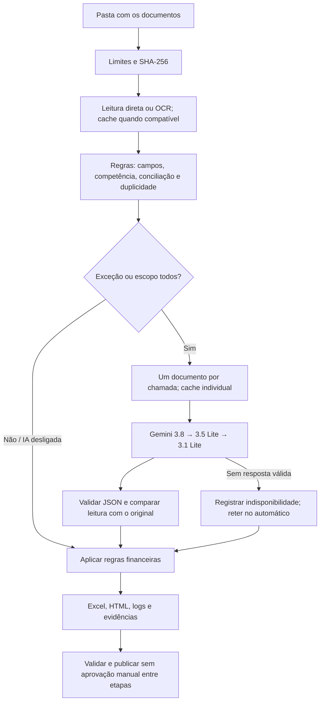
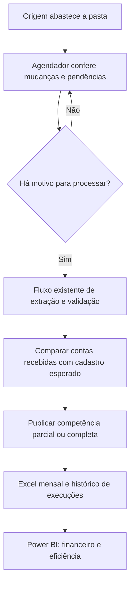

# Consolidação de extratos — Goener

Automação de fechamento bancário: lê PDFs, imagens e Excel, valida os dados e entrega uma planilha com uma linha por arquivo, relatório HTML e logs. O Python faz a extração e as regras financeiras; o Gemini complementa a análise das exceções.

## Executar no Windows, sem instalar Python

1. Extraia **todo o ZIP** `entrega/goener_automacao.zip` em uma pasta com permissão de escrita.
2. Mantenha `Goener.exe`, `config.toml`, `modelo.xlsx`, `.env` e a pasta `extratos/` juntos.
3. Coloque os documentos em `extratos/` e execute `Goener.exe`.

Também é possível executar pelo PowerShell, mantendo as mensagens visíveis:

```powershell
.\Goener.exe
.\Goener.exe --ai-mode off
.\Goener.exe --period 2026-11
```

O executável inclui o interpretador Python, bibliotecas e modelos OCR. Foi construído para **Windows x64**; não é um executável de Linux ou macOS. O modo de arquivo único extrai bibliotecas temporariamente na inicialização, por isso existe um tempo de abertura além do processamento medido. Não precisa executar pip nem ativar ambiente. OCR e regras rodam localmente; a IA precisa de internet e chave válida. O pacote privado inclui `.env`; não publique esse ZIP, pois ele contém a credencial autorizada para a avaliação.

**Validação da versão 1.8.0:** o relatório foi conferido no navegador e 110 testes passaram. O EXE 1.8.0 teve uma primeira tentativa bloqueada pelo Smart App Control (erro 4551). Em seguida, o usuário executou o mesmo binário com sucesso: 17 arquivos, cinco análises em cache, zero chamadas novas e resultados preservados. O motivo da mudança de decisão do Windows não foi identificado nos eventos. O binário continua sem assinatura; o bloqueio pode depender da política da máquina. A evidência atual está em `validacao/interface.json`; não se trata de teste em uma VM Windows limpa.

**Se o Windows bloquear o EXE:** tente executá-lo novamente. Nesta máquina, a primeira tentativa foi bloqueada e a segunda funcionou com o mesmo arquivo. Isso não garante que o Windows deixe de bloquear nas próximas execuções ou em outros computadores. Se persistir, use o código Python, conforme os dois comandos abaixo; não é necessário desativar a proteção do Windows. O bloqueio acontece antes de o programa iniciar e não é uma regra da automação.

**Onde estão os resultados?** Na pasta **`resultados/`**, na raiz do projeto:

- **`relatorio.html`** abre o último relatório concluído, com filtros e detalhes das ressalvas.
- **`consolidado.xlsx`** é a cópia da última planilha gerada. Feche-a antes de rodar novamente para permitir a atualização dessa cópia.
- As pastas com o identificador de cada execução guardam os respectivos Excel, HTML, logs e evidências. Se a cópia acima estiver aberta, a nova planilha continua disponível dentro da pasta da execução.

Por duplo clique no EXE, o relatório abre no navegador ao concluir. Pelo terminal, o programa informa os caminhos. `resultados/latest.json` identifica a última publicação. Saídas antigas em `.local/outputs/` continuam preservadas; os relatórios gerados não são enviados ao Git. Não há agendamento nem monitoramento automático instalados nesta versão.

A versão **1.8.1** torna a saída visível em `resultados/` e abre o HTML ao concluir por duplo clique. **112 testes passaram**, incluindo a publicação dos atalhos e o caso de a cópia do Excel estar aberta. O EXE 1.8.1 também foi executado pelo terminal nesta máquina: 17 arquivos processados e resultados publicados; a abertura automática do navegador por duplo clique ainda não foi verificada nesta versão.

## Executar pelo código-fonte

Esta é também a alternativa caso o Windows bloqueie `Goener.exe`. Instale o **Python 3.12**, abra o terminal na pasta do projeto e execute:

```powershell
py -3.12 -m pip install -r requirements-lock.txt
py -3.12 executar.py
```

O primeiro comando instala as dependências; o segundo executa a automação completa, com os mesmos arquivos, `.env` e resultados do EXE. Não basta instalar as dependências: é necessário executar `executar.py`. Nas próximas vezes, basta o segundo comando.

`py -3.12 -m goener` é uma entrada equivalente. No Linux/macOS, use um Python compatível e `python3 -m goener`; o executável distribuído continua sendo exclusivo de Windows. Não há criação de ambiente virtual. Para configurar a IA, copie `.env.example` como `.env`, ao lado de `config.toml`:

```dotenv
GEMINI_API_KEY=sua_chave_aqui
```

O Python lê esse arquivo automaticamente, com prioridade sobre variáveis do processo, sem sessão de navegador ou busca da chave no usuário do Windows. O Git ignora `.env`; somente o exemplo vazio é versionado. O robô não ativa faturamento. O projeto usado nos ensaios estava no Free Tier; o plano e as cotas efetivas devem ser conferidos no Google AI Studio.

Parâmetros operacionais, válidos também para `Goener.exe`:

```powershell
py -3.12 executar.py --ai-mode consultivo --ai-scope todos
py -3.12 executar.py --ai-mode off
py -3.12 executar.py --no-cache
py -3.12 executar.py --no-ocr
py -3.12 executar.py --strict
```

`config.toml` define entrada, saída, competência e limites. Os caminhos são relativos a esse arquivo. O case usa outubro de 2026; sem competência configurada, o Python usa o mês anterior em São Paulo.

## O que é entregue

A pasta `entrega/` mantém três arquivos: **ZIP da automação, consolidado Excel e documentação de uma página**. O ZIP inclui o executável Windows, fonte, entradas e resultado de referência em `resultado/`. Testes, logs e evidências técnicas ficam agrupados em `validacao/`, inclusive no Git, separados da operação. HTML, Excel e PDF gerados ficam apenas na entrega local e no ZIP privado; não são mais versionados. Os commits antigos continuam no histórico.

| Saída por execução | Finalidade |
| --- | --- |
| `consolidado.xlsx` | Aba Consolidado com as oito colunas obrigatórias, Resumo com fórmulas e Instruções preservada. |
| `relatorio.html` | Visão geral financeira, composição do saldo por banco, busca, filtros, IA, medidas aplicadas e acesso ao original. Sem análise de tempo. |
| `execucao.log` e `execucao.jsonl` | Eventos, duração, tentativas e conclusão por arquivo. |
| `evidencias.json` | Extração, conciliação, origem dos valores e resposta validada da IA. |
| `resumo.json` | Quantidades, saldo considerado, tempo, configuração e consumo de chamadas. |
| `manifesto.json` | Hashes dos documentos e das saídas para integridade. |

As oito colunas são **Arquivo, Banco, Conta, Período, Saldo final, Formato de origem, Status e Observação**. Uma linha por arquivo, inclusive cópias e falhas. Status: `ok`, `revisar` ou `falhou`.

O lote fornecido contém **17 arquivos: 12 ok, 4 revisar e 1 falhou**, com saldo aprovado de **R$ 4.114.372,29**. `EXT_102026_LagoaAzul (1).pdf` é cópia exata do original sem sufixo, identificada por SHA-256; permanece registrada e fora da soma. Também há possível lançamento repetido, divergência de R$ 1.080,00 em Sol do Sertão, extrato de setembro num lote de outubro e comunicado sem saldo. Nenhum saldo é corrigido para fazer a conciliação fechar.

### Editar a planilha

A aba Consolidado é uma tabela Excel chamada `Extratos`. Edite os valores nessa tabela; para acrescentar ou remover registros, use Inserir/Excluir linhas da tabela. O Resumo recalcula no Excel. A célula amarela B3 escolhe o mês; o total usa somente status `ok` dessa competência. Filtros visuais não mudam o total geral. O status tem lista de opções e cores dinâmicas.

Marcar `ok` é uma liberação manual sob responsabilidade do revisor: as fórmulas não repetem hash, OCR, conciliação ou IA. As observações descrevem a execução original. Salve uma cópia revisada; editar o Excel não atualiza o HTML, e uma nova execução não importa essas alterações.

## Fluxo atual



O processamento é sequencial, sem chamadas paralelas. `Decimal` preserva os centavos. A conciliação compara saldo inicial + movimentos com o saldo final declarado. Cópias exatas e competência diferente são excluídas dos totais, sem apagar linhas ou originais. Suspeitas e divergências ficam retidas com explicação; o fluxo não espera intervenção humana para terminar.

O lock evita execuções concorrentes. As saídas são montadas temporariamente e publicadas após validação. Para parar entre arquivos, crie `.local/runtime/STOP`; remova para uma nova execução. Se sobrar um lock após interrupção abrupta, confira se o processo terminou antes de removê-lo. Códigos de saída: `0` publicado, `1` infraestrutura/configuração, `2` pendências em modo estrito, `3` parada, `130` interrupção.

### Hash e cache

SHA-256 é uma impressão digital dos bytes do arquivo, calculada localmente com `hashlib`. Reconhece cópias exatas; documentos com os mesmos dados mas outra estrutura podem ter hashes diferentes. Banco, conta e competência repetidos em conteúdos diferentes recebem uma ressalva própria. A leitura também verifica se o original mudou durante o processamento ou antes do envio à IA; uma alteração nessa janela bloqueia aquela análise.

O SQLite, acessado pela biblioteca padrão `sqlite3`, guarda dados em `.local/runtime/`. `extractions.sqlite3` reaproveita extrações por hash, formato, código e opções de leitura, reaplicando as regras em cada execução. `gemini.sqlite3` guarda respostas válidas, tentativas e bloqueios de cota. A resposta de IA é reutilizada por até 30 dias se modelo, instruções e requisição forem iguais. Mudar low/high invalida essa chave. Não se armazena a chave da API nesses bancos. `--no-cache` força nova análise, respeitando cotas.

### OCR e envio multimodal

RapidOCR usa **PP-OCRv4 Mobile com ONNX Runtime em CPU**, retornando texto, confiança e posição dos trechos. Baixa confiança gera ressalva. PDF com texto utilizável é lido pelo pdfplumber; páginas digitalizadas usam OCR. Excel é lido pelo openpyxl. Não usamos Tesseract nem afirmamos superioridade sem benchmark.

No padrão `ai_document_mode = "completo"`, o Gemini recebe **o PDF ou a imagem original**, codificados em Base64 no campo `inlineData` de um POST HTTPS. `mimeType` identifica o formato. Base64 é transporte, não OCR, criptografia ou compactação. O modelo multimodal reconstrói e analisa texto e elementos visuais. Junto seguem extração local, premissas, movimentos e problemas identificados. O modo `dados` envia somente a extração disponível.

Para Excel, enviamos as células preenchidas de todas as abas como texto estruturado, preservando aba, endereço e conteúdo. Por exemplo, uma aba Extrato com Banco em A1, Banco Aurora em B1, Saldo final em A2 e 1.234,56 em B2 chega assim:

```json
{"source_workbook":[{"sheet":"Extrato","visibility":"visible","cells":[
  {"cell":"A1","value":"Banco"},{"cell":"B1","value":"Banco Aurora"},
  {"cell":"A2","value":"Saldo final"},{"cell":"B2","value":"1234.56"}
]}]}
```

Os conteúdos são serializados como strings. Fórmulas seguem literalmente como texto, sem execução. Gráficos, imagens incorporadas e formatação do Excel não são enviados. O mapa permite citar “aba Extrato, célula B2”.

Limites: até 8 MB por original enviado, limite de páginas/pixels configurado, até 30 mil células e 100 mil caracteres por contexto/texto de planilha. Exceder limites registra indisponibilidade; não há corte silencioso. Caminhos fora da entrada, links simbólicos e alteração de hash são bloqueados.

### IA: decisão, raciocínio e disponibilidade

Padrão: **automático somente nas exceções**, uma chamada por documento (`ai_batch_size = 1`). Os 12 arquivos regulares dispensam IA. Consultivo registra orientação sem mudar a seleção pelas regras. Automático aplica retenções e exclusões, mas não supera bloqueios financeiros obrigatórios nem altera banco, conta, período ou saldo extraídos.

O contrato JSON exige `decision`, `reason` e `evidence_codes`; no modo completo, também `source_check` com banco, conta, período, saldo, legibilidade, localização e citação. O Python valida campos, tipos, códigos e coerência com a leitura local. JSON válido não comprova interpretação correta. As instruções ficam versionadas em `goener/ai.py`, sem agente persistente ou treinamento de pesos. Arquivos, fórmulas e OCR são dados não confiáveis; suas instruções não são executadas. O modelo não recebe ferramentas.

**3.8 → 3.5 Flash-Lite → 3.1 Flash-Lite**, com a mesma chave/projeto. Cada modelo pode fazer até três tentativas para 500/502/503/504, timeout ou rede, com espera crescente. HTTP 429 alterna diretamente, registrando cota e espera quando informadas. 400/401/403, contrato inválido e bloqueio de segurança não são contornados por outro modelo. Uma decisão válida encerra a busca, inclusive negativa. Se todos falharem, o lote termina com a ressalva. Resultados individuais concluídos não são reenviados nessa execução.

O programa respeita orçamento de tempo, pausa de modelos e cotas persistentes. O limite local dos Lite é 12 RPM/450 RPD, abaixo dos 15 RPM/500 RPD observados no projeto; para o 3.8, aplica o teto observado de 5 RPM/20 RPD. Os valores atuais do provedor prevalecem; consumo em outros programas não é visto pelo contador local. A cota diária renova à meia-noite do Pacífico. Não existe garantia de disponibilidade externa.

Os três modelos recebem **thinking HIGH**. PDFs/imagens usam também **resolução de mídia HIGH**: são controles independentes, como esforço de análise e detalhe de uma lupa. O OCR local não possui esse low/high. O teto definido pelo robô é 8.192 tokens de geração por chamada, incluindo raciocínio e resposta, sem contar a entrada. Ele não obriga o modelo a gastar o teto.

Nos cinco documentos do ensaio, o total passou de **23.382 tokens em low para 27.911 em high**, com entradas iguais: 22.512 tokens em ambas as rodadas. Em high, foram 4.518 tokens de raciocínio e 881 de resposta. Foram cinco chamadas e cinco respostas válidas; esse ensaio não garante uma proporção fixa nem prova maior precisão. Registros em `validacao/comparacao_tokens.json` e nas execuções preservadas. Em projeto pago, raciocínio pode aumentar o custo; no Free Tier continuam valendo cotas e disponibilidade. Metadados de uso ficam em `ai.usage`, sem copiar raciocínio interno para os relatórios.

`ai_batch_size = 5` permanece como opção de agrupamento. Nesse modo, IDs associam cada resultado ao documento; uma falha exige reenviar o grupo completo. O padrão individual foi escolhido para reduzir retrabalho e facilitar retomadas.

## Estrutura e validação

```text
executar.py          entrada simples e ponto de empacotamento
config.toml          parâmetros
modelo.xlsx          modelo fornecido
extratos/            documentos fictícios de entrada
goener/              leitura, regras, IA, relatórios e empacotamento
validacao/           testes, execuções anteriores, logs e evidências
entrega/             ZIP, consolidado e documentação de uma página
.local/              execução e construção locais; fora do Git
```

`goener/` mantém cinco módulos operacionais: `core.py`, `readers.py`, `ai.py`, `reporting.py` e `pipeline.py`; `report.html` é a apresentação e `entrega.py` prepara os arquivos de envio. A integração contínua está em `.github/`. Não há servidor web, banco remoto ou instalação de serviço Windows.

Veja **[validacao/README.md](validacao/README.md)** para o histórico selecionado e como reproduzir os testes. Os registros antigos preservam as configurações, commits, logs e resultados das respectivas rodadas. A migração para o executável tem evidência própria; não se presume funcionamento apenas porque o empacotamento terminou.

### Reconstruir o executável e a entrega

Somente quem desenvolve precisa de Python e PyInstaller:

```powershell
py -3.12 -m pip install -r requirements-lock.txt
py -3.12 -m pip install -e ".[build]" --no-build-isolation
py -3.12 -m goener.entrega --build-exe --include-env
```

PyInstaller e hooks são fixados no `pyproject.toml`. Intermediários ficam em `.local/build/`; o binário em `.local/bin/Goener.exe`. `--exe .local/bin/Goener.exe` reutiliza um binário já construído. Sem `--include-env`, a chave não entra no ZIP. Fonte e configurações ficam legíveis no repositório; o executável não é proteção do código. Ele deve ser reconstruído quando o código operacional mudar. Distribua sempre o ZIP completo, não apenas o EXE sem seus arquivos externos.

## Dados de tempo para o futuro BI

O HTML é exclusivamente financeiro e operacional. Não contém painel de produtividade nem estimativa de revisão humana.

Referência informada pelo responsável por amostragem de um arquivo: **8 minutos para preencher + 2 minutos para conferir os valores = 10 minutos por arquivo**. A automação não auditou essa cronometragem; o formato/arquivo da amostra não foi identificado. A extrapolação não é uma média medida de todos os formatos.

O `resumo.json` guarda separadamente, em `time_estimate`:

- referência manual declarada e tamanho da amostra;
- projeção para o volume: `17 × (8 + 2) = 170 minutos`, ou 2h50;
- duração do processamento efetivamente medida pelo robô;
- diferença projetada apenas para a etapa de consolidação;
- indicação de cache, para não confundir reexecução com primeira execução.

Não são estimados minutos de revisão humana com automação, espera pelo banco, recebimento ou implantação. A comparação e a apresentação dessas informações ficam reservadas à página de tempo do BI. Não há conversão para dinheiro.

## Próximos passos, por prioridade

1. **P1 — Definir um critério mínimo de fechamento com o financeiro.** Cadastro por banco e conta ativa, competência esperada e prazo de entrega. Cada conta esperada precisa ter um extrato válido do mês, com saldo e identificação, sem bloqueio crítico. Cópias não contam duas vezes; recebido não significa validado. Contas ausentes mantêm o fechamento parcial. No prazo, publicar entrega com ressalvas sem chamá-la de completa. A quantidade de arquivos, sozinha, não comprova completude.
2. **P2 — Agendar conferência da pasta e consolidar por mês.** Verificar a cada hora ou diariamente e comparar inclusões, alterações e remoções por hash. Mudança de código/configuração/competência, prazo atingido ou IA pendente com nova janela também podem exigir processamento. Reconstruir `resultados/AAAA-MM/consolidado.xlsx`, sem acrescentar linhas duplicadas; publicar somente após validação e preservar histórico. Revisões manuais ficam em cópia separada. Esta evolução ainda não está implementada.
3. **P3 — Disponibilizar análise histórica no Power BI e homologar a operação.** Confirmar a origem usada pela empresa (SharePoint, OneDrive corporativo ou outra), publicar dados em estrutura estável e configurar atualização depois do robô. Ampliar layouts e avaliar decisões da IA com a gestão. Não há BI ou integração SharePoint implementados nesta versão.



Este desenho é futuro. O processo só inclui recebimento sem trabalho manual se a origem abastecer a pasta automaticamente. Ausência de mudanças não significa que todos os documentos chegaram. O robô não autentica extratos nem substitui conciliação com o razão contábil.

### Por que Power BI antes de um sistema web

Para este case, a recomendação é usar o robô como produtor dos dados e o Power BI como leitura gerencial. Um sistema web acrescentaria upload, autenticação, hospedagem e manutenção antes de demonstrar mais valor financeiro. O Power BI tem [conector de pasta SharePoint](https://learn.microsoft.com/en-us/power-query/connectors/sharepoint-folder); publicação e atualização dependem de credenciais, infraestrutura e licenças disponíveis na empresa.

Duas páginas são suficientes: **Financeiro**, com saldos por banco/conta, competência, histórico e ressalvas; **Tempo e operação**, com duração, arquivos processados, falhas, uso da IA, cache e horas estimadas liberadas. Não converter horas para dinheiro sem premissas aprovadas. Separar tempos reais do robô de hipóteses de trabalho humano, e execuções frias de reexecuções com cache.

O financeiro deve escolher a última versão válida de cada competência, sem somar novamente o mesmo mês a cada reprocessamento. O histórico operacional preserva todas as execuções, identificadas por run_id. Atualização do BI deve ser configurada após a publicação dos dados pelo robô; salvar um arquivo na nuvem não garante atualização instantânea do relatório. [Atualização do Power BI](https://learn.microsoft.com/en-us/power-bi/connect-data/refresh-data).

## Referências

- [PyInstaller: distribuição sem Python instalado](https://pyinstaller.org/en/stable/operating-mode.html)
- [RapidOCR](https://rapidai.github.io/RapidOCRDocs/main/en/install_usage/rapidocr/usage/)
- [Gemini: documentos e Base64](https://aistudio.google.com/docs/document-processing)
- [Gemini: thinking e consumo](https://aistudio.google.com/docs/thinking)
- [Gemini: resolução de mídia](https://aistudio.google.com/docs/media-resolution)
- [Gemini: cotas](https://aistudio.google.com/docs/rate-limits)
- [Gemini: faturamento](https://aistudio.google.com/docs/billing)
